<div align="center">


<br>


**[Architecture](#architecture)** &nbsp;|&nbsp; **[Results](#results-at-a-glance)** &nbsp;|&nbsp; **[Explore each detection](#explore-each-detection)** &nbsp;|&nbsp; **[Custom rule spotlight](#spotlight-custom-rule-100100)** &nbsp;|&nbsp; **[Repo map](#repository-map)**

</div>

---

## TL;DR

I built a small Security Operations Centre in Microsoft Azure: a **Wazuh** SIEM watching a **Windows Server 2022** endpoint instrumented with **Sysmon**. I then simulated six attacker techniques, triaged the alerts like a Tier 1 analyst, wrote an incident report and a playbook for each, and authored one **custom detection rule** that I tested with a true positive and a negative control.

- **Everything is mine to explain:** I deployed it, broke it, debugged it and tore it down the same day.
- **One real bug, documented:** my first version of the custom rule silently failed because Wazuh stores Windows paths with doubled backslashes. Finding that is the best part of the project: [read the story](investigation-notes/detection-engineering-writeup.md).
- **Honest scope:** one endpoint, activity generated by me on the host, no network sensor. See [limitations](#limitations-and-next-steps).

> **Ethical and legal notice.** All activity happened inside my own Azure subscription, on VMs I created and later deleted. Inbound access (SSH, RDP, the Wazuh dashboard) was restricted to my own public IP by network security groups. No third-party system was scanned, attacked or accessed.

---

## Architecture

<div align="center">
</div>

| Component | Detail |
|---|---|
| Cloud | Microsoft Azure, India South Central, one resource group, VNet `172.16.0.0/24` |
| `wazuh-mgr` | Ubuntu 24.04, D2as_v4 (2 vCPU / 8 GiB), Wazuh 4.14.10 all-in-one (manager, indexer, dashboard), `172.16.0.4` |
| `win-target` | Windows Server 2022, D2as_v4, Sysmon 15.22 (SwiftOnSecurity config) + Wazuh agent, `172.16.0.5` |
| Exposure | SSH, RDP and the dashboard allowed from one source IP only; agent traffic stays on the private network |

More detail: [network design](lab-setup/network-design.md) &nbsp;|&nbsp; [VMs and cost](lab-setup/virtual-machines.md) &nbsp;|&nbsp; [Azure build and teardown](lab-setup/azure-deployment-and-teardown.md)

---

## Results at a glance

| # | Technique (MITRE) | What I did | What fired | Level | Time (IST) |
|---|---|---|---|---|---|
| 1 | Brute force (T1110.001) | Failed RDP logons from my workstation | 60122 x8, then **60204** | 5, **10** | 17:50:24 |
| 2 | New admin account (T1136.001, T1098) | `net user` then add to Administrators | 60109 x2, 60170, **60154** | 8, 5, **12** | 18:00:20 |
| 3 | Scheduled task (T1053.005) | `schtasks /create ... /ru SYSTEM` | **60228** | 4 | 18:10:12 |
| 4 | Encoded PowerShell (T1059.001, T1027) | `-EncodedCommand` with policy bypass | **92057** | **12** | 18:17:32 |
| 5 | Log cleared (T1070.001) | `wevtutil cl Security` | **63103** | 5 | 18:22:43 |
| 6 | Service from user-writable path (T1543.003) | `sc.exe create` with a `Public` folder binary | 61138 (stock), then **100100 (custom)** | 5, **12** | 18:41:28 |

Four of the six were caught by stock rules at a sensible level. Two exposed gaps worth fixing: the log-clearing rule is only **level 5**, and the service rule was too noisy until I wrote 100100.

**Session timeline (all on 17 November 2026, IST):**

```mermaid
gantt
    title One working session, 17 November 2026 (IST)
    dateFormat  HH:mm
    axisFormat  %H:%M
    section Setup
    Sysmon + Wazuh agent online        :done, s1, 17:35, 10m
    section Scenarios
    1 Brute force                      :crit, a1, 17:49, 3m
    2 New admin account                :crit, a2, 17:59, 2m
    3 Scheduled task                   :a3, 18:10, 2m
    4 Encoded PowerShell               :crit, a4, 18:17, 2m
    5 Security log cleared             :a5, 18:22, 2m
    6 Service + custom rule 100100     :active, a6, 18:26, 17m
```

---

## Explore each detection

Click a row to open it. Each one links to the full write-up, the incident report and the playbook.

<details>
<summary><b>1. Brute force login attempt</b> &nbsp;|&nbsp; T1110.001 &nbsp;|&nbsp; rules 60122 and 60204</summary>

<br>

**What happened:** repeated failed RDP logons for `labadmin`, from my own workstation to the VM's public IP.

**What Wazuh did:** every failure raised level-5 rule 60122. After eight failures from one source within 240 seconds, rule **60204** raised a level-10 alert.

**Worth knowing:** the failures logged as **logon type 3 (NTLM)**, not type 10. RDP with Network Level Authentication checks the credentials before a session exists, so a filter on type 10 would miss it.

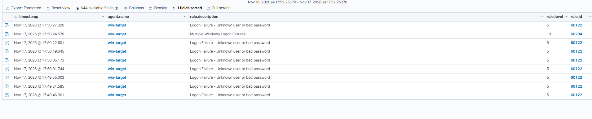

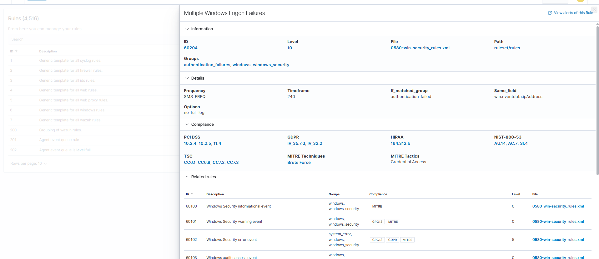

[Scenario](attack-scenarios/failed-login-bruteforce.md) &nbsp;|&nbsp; [IR-001](incident-reports/IR-001-brute-force.md) &nbsp;|&nbsp; [Playbook](playbooks/brute-force-response-playbook.md) &nbsp;|&nbsp; [Alert JSON](sample-logs/60204-bruteforce-alert.json)

</details>

<details>
<summary><b>2. New local admin account</b> &nbsp;|&nbsp; T1136.001, T1098 &nbsp;|&nbsp; rules 60109, 60170, 60154</summary>

<br>

**What happened:** account `labtest` created, then added to the local Administrators group 54 seconds later.

**What Wazuh did:** four alerts. The routine steps scored 5 to 8; the **Administrators group change scored 12**.

**Worth knowing:** Wazuh tagged the group change as T1484 (Domain Policy Modification), which does not fit a local group on a standalone server. My reports use T1136.001 and T1098 instead.

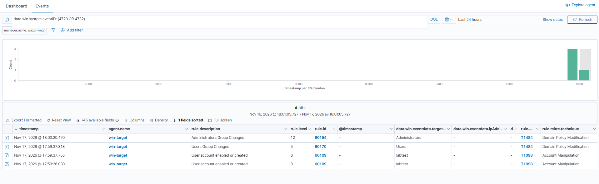

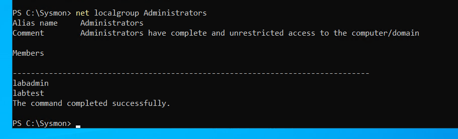

[Scenario](attack-scenarios/new-admin-account-created.md) &nbsp;|&nbsp; [IR-002](incident-reports/IR-002-new-admin-account.md) &nbsp;|&nbsp; [Playbook](playbooks/unauthorised-admin-account-playbook.md) &nbsp;|&nbsp; [Alert JSON](sample-logs/60154-admin-group-changed-alert.json)

</details>

<details>
<summary><b>3. Scheduled task persistence</b> &nbsp;|&nbsp; T1053.005 &nbsp;|&nbsp; rule 60228</summary>

<br>

**What happened:** a task named `LabUpdateCheck` set to run as SYSTEM at logon. The name imitates a routine update job.

**What Wazuh did:** rule **60228** (level 4), with the whole task XML inside the alert, so I could read the trigger, the principal and the command without extra tooling.

**Worth knowing:** level 4 is low for persistence, and one earlier 4698 alert at 17:43:54 predates my test. I did not check the audit baseline before changing it, so I do not claim task creation is off by default. The surrounding events also show a Security 4688 record for `schtasks.exe` launched by PowerShell.

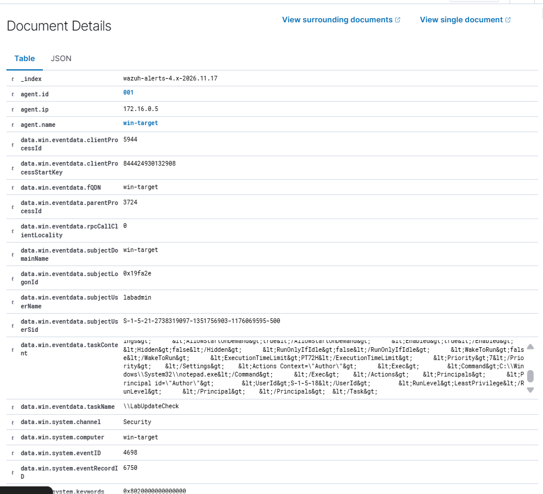

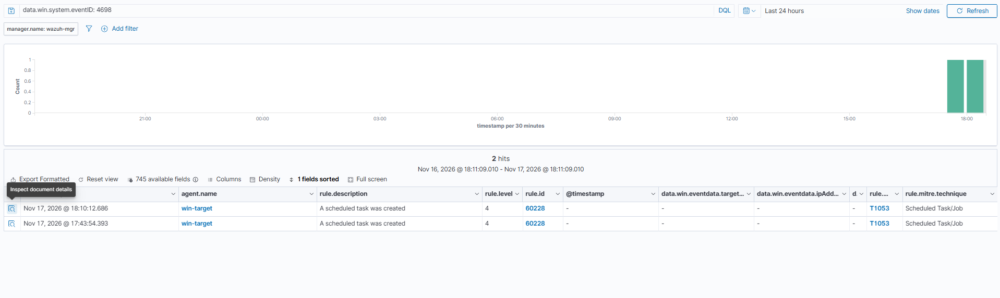

[Scenario](attack-scenarios/scheduled-task-persistence.md) &nbsp;|&nbsp; [IR-003](incident-reports/IR-003-scheduled-task.md) &nbsp;|&nbsp; [Playbook](playbooks/persistence-task-service-playbook.md) &nbsp;|&nbsp; [Alert JSON](sample-logs/60228-scheduled-task-created-alert.json)

</details>

<details>
<summary><b>4. Encoded PowerShell</b> &nbsp;|&nbsp; T1059.001, T1027 &nbsp;|&nbsp; rule 92057</summary>

<br>

**What happened:** a harmless command was Base64-encoded and run with `-NoProfile -ExecutionPolicy Bypass -EncodedCommand`.

**What Wazuh did:** stock rule **92057** fired at **level 12** within a second, from the Sysmon process-creation event. The event carried the command line, the parent process, the user, the integrity level and the file hashes.

**Worth knowing:** the rule's description names a PowerShell parent. I only tested that case, so other launchers are untested.

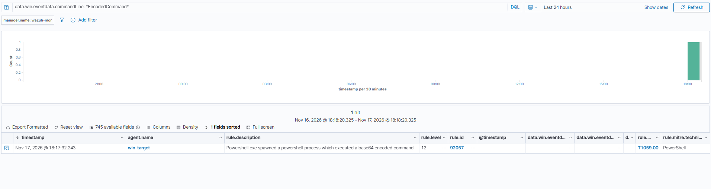

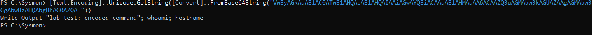

[Scenario](attack-scenarios/suspicious-powershell-encoded.md) &nbsp;|&nbsp; [IR-004](incident-reports/IR-004-suspicious-powershell.md) &nbsp;|&nbsp; [Playbook](playbooks/suspicious-powershell-response-playbook.md) &nbsp;|&nbsp; [Alert JSON](sample-logs/92057-powershell-encoded-alert.json)

</details>

<details>
<summary><b>5. Security log cleared</b> &nbsp;|&nbsp; T1070.001 &nbsp;|&nbsp; rule 63103</summary>

<br>

**What happened:** `wevtutil cl Security` emptied the local Security log.

**What Wazuh did:** rule **63103** alerted and named `labadmin` and the logon session. All earlier evidence stayed in Wazuh because the agent had already forwarded it, which is the practical argument for central logging.

**Worth knowing:** the stock level is only **5**, which is low for evidence tampering. A custom rule to raise it is my next improvement.

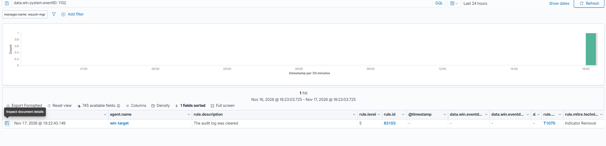

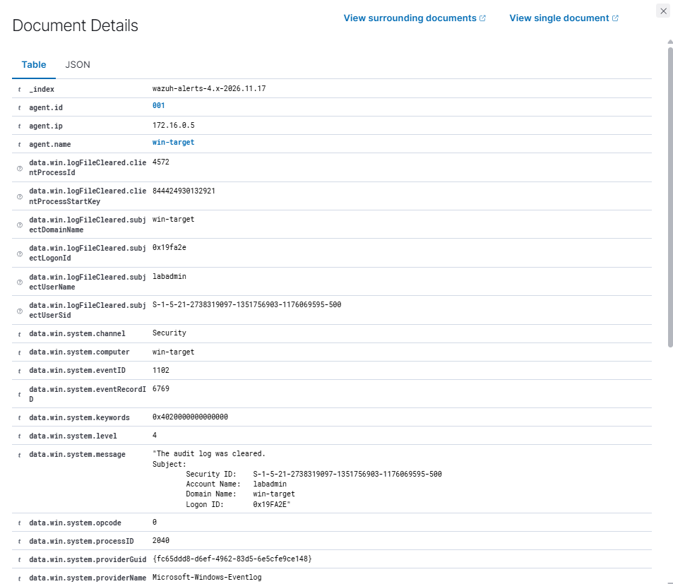

[Scenario](attack-scenarios/audit-log-cleared.md) &nbsp;|&nbsp; [IR-005](incident-reports/IR-005-log-clearing.md) &nbsp;|&nbsp; [Alert JSON](sample-logs/63103-log-cleared-alert.json)

</details>

<details>
<summary><b>6. Service from a user-writable path</b> &nbsp;|&nbsp; T1543.003 &nbsp;|&nbsp; rule 61138 and custom rule 100100</summary>

<br>

**What happened:** two services were created, `LabBadSvc` pointing into `C:\Users\Public\` and `LabGoodSvc` pointing into `System32`.

**What Wazuh did:** stock rule 61138 alerts on every new service at level 5, which is too noisy to act on. My custom rule **100100** escalates only the bad one to level 12. Full story below.

[Scenario](attack-scenarios/malicious-service-creation.md) &nbsp;|&nbsp; [IR-006](incident-reports/IR-006-malicious-service.md) &nbsp;|&nbsp; [Playbook](playbooks/persistence-task-service-playbook.md) &nbsp;|&nbsp; [Alert JSON](sample-logs/100100-service-user-writable-path-alert.json)

</details>

---

## Spotlight: custom rule 100100

Stock rule 61138 fires at level 5 for **every** new Windows service, including Sysmon's own install. I wrote a child rule that escalates only services whose binary sits in a folder any user can write to:

```xml
<rule id="100100" level="12">
  <if_sid>61138</if_sid>
  <field name="win.eventdata.imagePath" type="pcre2">(?i)\\{1,2}(temp|appdata|downloads|users\\{1,2}public)\\{1,2}</field>
  <description>Windows service installed from a user-writable path: $(win.eventdata.imagePath)</description>
  <mitre><id>T1543.003</id></mitre>
</rule>
```

**The bug.** My first version used a single-backslash pattern. It loaded without errors, the parent rule fired, and the rule still did not match.

| Test | Path | Version 1 | Version 2 |
|---|---|---|---|
| Malicious path | `C:\Users\Public\updater.exe` | **Missed** (61138 only) | **100100 fired**, level 12 |
| Legitimate path (control) | `C:\Windows\System32\notepad.exe` | 61138 only | 61138 only, no false positive |

**The cause.** Wazuh holds `imagePath` with **doubled backslashes** (`C:\\Users\\Public\\updater.exe`) while the readable message holds single ones. I found it by comparing my pattern with the real alert JSON, not by guessing. The fix `\\{1,2}` accepts either form. `wazuh-logtest` could not replay this event type, so I verified with a live test and a control.

<table>
<tr>
<td width="33%"><b>Version 1 pattern</b><br>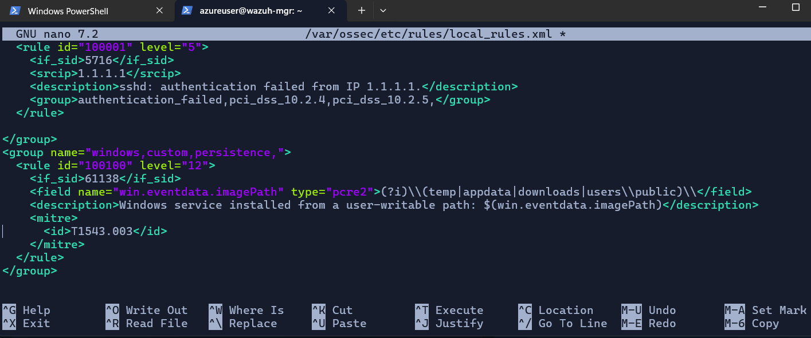</td>
<td width="33%"><b>Before the fix</b><br>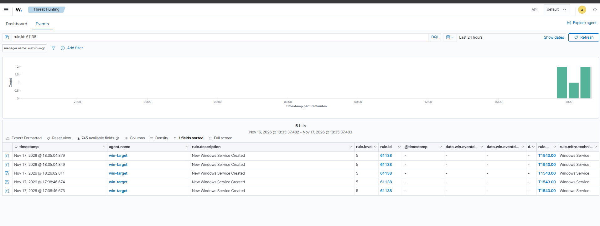</td>
<td width="33%"><b>After the fix</b><br>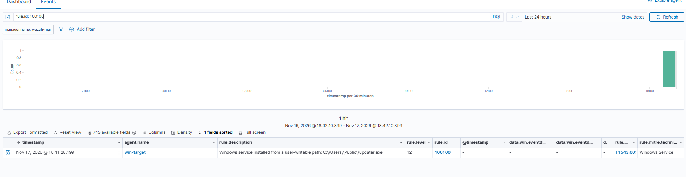</td>
</tr>
</table>

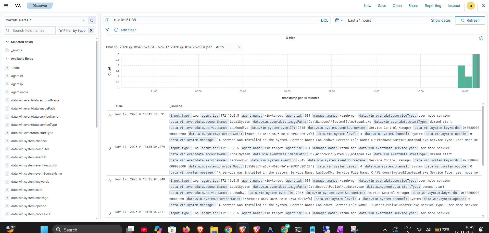

Read more: [detection-engineering write-up](investigation-notes/detection-engineering-writeup.md) &nbsp;|&nbsp; [rule file](detection-rules/local_rules_100100.xml) &nbsp;|&nbsp; [rule documentation](detection-rules/wazuh-rules.md) &nbsp;|&nbsp; [Sigma draft](draft-rules/sigma-rules.md)

**Known limits:** an attacker can pick another folder, and legitimate per-user software installed under `AppData` would trigger it. It is one layer, not a complete defence.

---

## What this project shows

| Skill | Where to see it |
|---|---|
| Cloud lab engineering under real constraints (region policy, size limits, NSG hardening, disk sizing) | [Azure build and teardown](lab-setup/azure-deployment-and-teardown.md) |
| SIEM deployment and endpoint onboarding | [Wazuh setup](lab-setup/wazuh-setup.md), [Sysmon](lab-setup/sysmon-configuration.md) |
| Windows event analysis (4625, 4720, 4732, 4698, 1102, 7045, Sysmon 1) | [Event ID notes](investigation-notes/windows-event-ids.md) |
| Triage and correlation across alerts (one logon ID ties scenarios 2 to 5 together) | [Timeline analysis](investigation-notes/timeline-analysis.md) |
| Detection engineering: write, test, debug, document | [Rule write-up](investigation-notes/detection-engineering-writeup.md) |
| Critical reading of tool output (a wrong ATT&CK tag, a rule level that is too low) | [Wazuh rules](detection-rules/wazuh-rules.md) |
| Incident reporting and response playbooks | [Reports](incident-reports/), [Playbooks](playbooks/) |
| Cost control and clean teardown, verified | [Teardown](lab-setup/azure-deployment-and-teardown.md) |

---

## Repository map

<details>
<summary>Open the folder tree</summary>

```
azure-wazuh-soc-lab/
├── lab-setup/              Azure build, Wazuh and Sysmon configuration, teardown
├── attack-scenarios/       Six scenarios, one document each
├── detection-rules/        Stock rules observed and custom rule 100100 (tested)
├── draft-rules/            Sigma drafts (written, not validated)
├── investigation-notes/    Event IDs, master timeline, detection-engineering write-up
├── incident-reports/       IR-001 to IR-006
├── playbooks/              Four response playbooks
├── sample-logs/            Seven sanitised Wazuh alerts
├── screenshots/            Evidence, grouped by scenario
├── diagrams/               Mermaid diagrams and an ATT&CK Navigator layer
└── assets/                 Animated README graphics
```

</details>

---

## Reproduce it

1. Create an Azure resource group, a VNet and two VMs ([sizes and constraints](lab-setup/virtual-machines.md)).
2. Install Wazuh with the installation assistant and enrol the Windows VM ([steps](lab-setup/wazuh-setup.md)).
3. Install Sysmon and add the forwarding block ([steps](lab-setup/sysmon-configuration.md)).
4. Run the six scenarios from [`attack-scenarios/`](attack-scenarios/) and compare your alerts with [`sample-logs/`](sample-logs/).
5. Delete the resource group and verify with `az group list`.

Use your own subscription, restrict every management port to your own IP, and set a budget alert before creating anything.

---

## Limitations and next steps

- **One Windows endpoint.** No Linux host and no domain controller.
- **No network sensor.** Port scans and lateral movement are out of scope without Suricata or Zeek.
- **Self-generated activity.** I ran the commands on the host and generated the failed RDP logons from my own workstation. There was no separate attacker VM.
- **Next:** raise the log-clearing rule from level 5, add an allow-list to rule 100100, test the PowerShell rule with other parent processes, add a Linux endpoint with auditd, and convert the Sigma drafts and test them.

---

## Acknowledgements and licence

The folder layout was adapted from the public project [harryklrr/soc-detection-lab](https://github.com/harryklrr/soc-detection-lab) (MIT). The infrastructure, configurations, scenarios, evidence and write-ups in this repository come from my own Azure deployment. The Sysmon configuration is the community [SwiftOnSecurity sysmon-config](https://github.com/SwiftOnSecurity/sysmon-config).

Released under the [MIT licence](LICENSE).

<div align="center">

*Last updated: 18 November 2026 | Author: Shreyas Desai | Target role: SOC Analyst / Junior Cyber Security Analyst*

</div>
