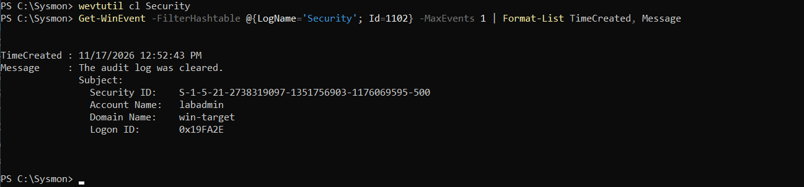
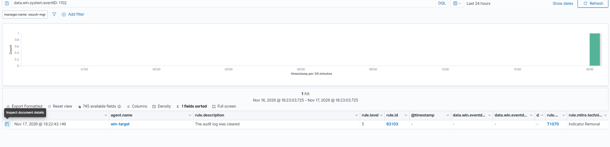
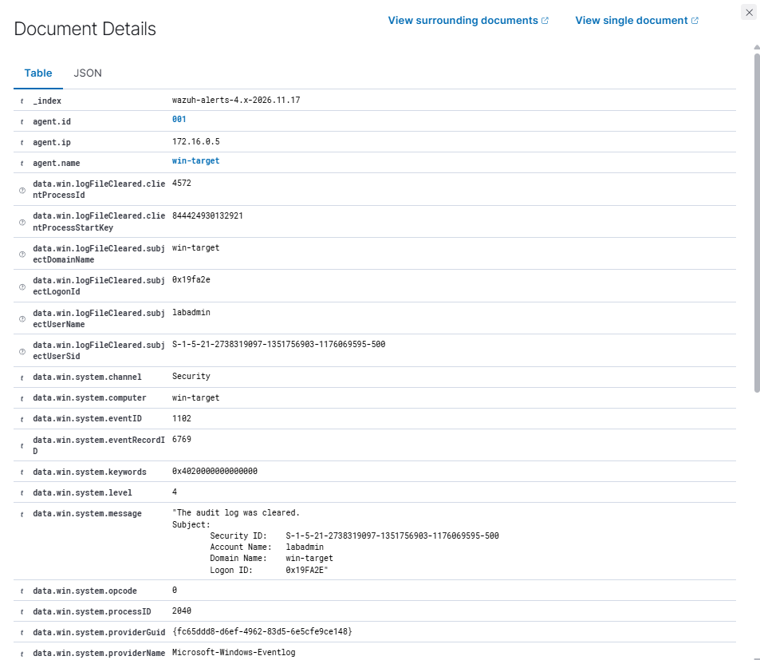

# Scenario 5: Security Log Cleared

## 1. Scenario Overview

The Windows Security event log was cleared with `wevtutil`. Attackers do this to remove evidence of their activity. Because the endpoint forwards its logs to Wazuh, the earlier evidence remained available in the SIEM even after the local log was emptied.

---

## 2. Objective

- Trigger Event 1102 ("The audit log was cleared")
- Confirm Wazuh alerts on it
- Show why off-host log collection matters

---

## 3. Lab Environment

| Component | Detail |
|---|---|
| Target | `win-target`, Windows Server 2022 |
| Acting account | `labadmin` |
| Prerequisite | Screenshots of earlier scenarios were captured before clearing |

---

## 4. Simulated Activity

In an elevated PowerShell:
```powershell
wevtutil cl Security
Get-WinEvent -FilterHashtable @{LogName='Security'; Id=1102} -MaxEvents 1 | Format-List TimeCreated, Message
```

---

## 5. Logs Generated

| Source | Event | Meaning |
|---|---|---|
| Security | 1102 | The audit log was cleared. It is the first entry of the new, empty log. |
| Sysmon | Event 1 | `wevtutil.exe` with the command line `cl Security` |

Search used:
```
data.win.system.eventID: 1102
```

---

## 6. Detection Logic

Wazuh's built-in rule for cleared audit logs is **63103**, level **5**, "The audit log was cleared" (groups `windows`, `windows_logs`, `log_clearing_auditlog`), tagged T1070. The alert named `labadmin` as the subject (`data.win.logFileCleared.subjectUserName`) with logon ID `0x19FA2E`, the same session as the earlier scenarios. Raised at 18:22:43 IST.

Level 5 is low for an action attackers use to hide their tracks, so raising it with a custom rule would be a sensible improvement.

A Sysmon process-creation event for `wevtutil.exe` would be a second, independent record of how the log was cleared. `[TODO: add it if captured]`

---

## 7. Investigation Steps

1. Searched for Event 1102 and read the alert and the account that cleared the log.
2. Searched Sysmon for `wevtutil.exe` around the same time to get the command line.
3. Compared the local Security log (empty apart from the 1102 entry) with Wazuh (full history), which demonstrates the value of central collection.
4. Looked at what happened immediately before the clear, since that is likely what someone wanted to hide.

---

## 8. Evidence / Screenshots

| File | Description |
|---|---|
| `05-audit-log-cleared/01-powershell-wevtutil-clear-security-and-event-1102.png` | `wevtutil cl Security`, then the 1102 event read back with `Get-WinEvent` |
| `05-audit-log-cleared/03-wazuh-1102-search-rule-63103-level-5.png` | Search `data.win.system.eventID: 1102`: rule 63103, level 5 |
| `05-audit-log-cleared/04-wazuh-1102-event-details-logfilecleared-fields.png` | Event fields: who cleared the log (`logFileCleared.*`) |
| `05-audit-log-cleared/05-wazuh-1102-event-details-rule-63103-mitre-t1070.png` | Rule fields: 63103, level 5, tagged T1070 |





---

## 9. MITRE ATT&CK Mapping

| Field | Value |
|---|---|
| **Tactic** | Defense Evasion |
| **Technique** | T1070.001, Indicator Removal: Clear Windows Event Logs |
| **Reference** | https://attack.mitre.org/techniques/T1070/001/ |

---

## 10. Response / Remediation

- Treat as high severity: legitimate administrators rarely clear the Security log
- Identify the account and session, then review activity before the clear
- Preserve the Wazuh data and take disk or memory images if compromise is suspected
- Restrict who can clear logs and alert on 1102 and 104 (System log cleared)

---

## 11. Lessons Learned

- Clearing the local log did not erase the evidence, because it was already in Wazuh. That is the practical argument for centralised logging.
- The clear itself is still a strong alert, and it records who did it.
- An empty search result is not proof of a gap. Verify the query before concluding a rule is missing.

---

## 12. Status

✅ Complete: 17 November 2026
