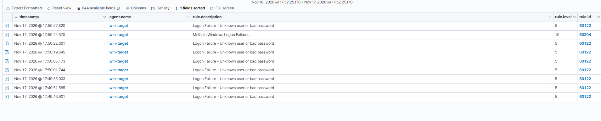
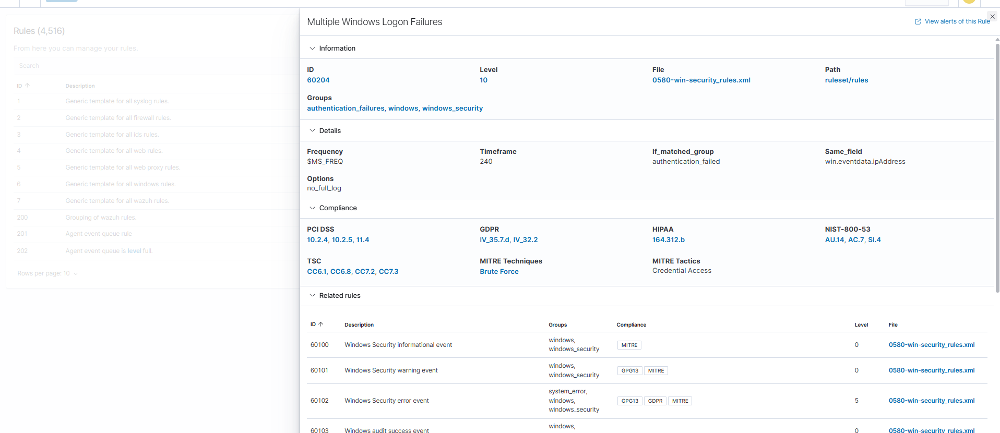

# Scenario 1: Failed Login / Brute Force Detection

## 1. Scenario Overview

Repeated failed Remote Desktop logons for the local administrator account `labadmin` were generated from my own workstation against the Windows VM's public address. Wazuh recorded each failure as Event 4625 and raised a level-10 correlation alert once enough failures accumulated.

---

## 2. Objective

- Generate repeated failed logons against the Windows target
- Confirm Event 4625 is collected and alerted on by Wazuh
- Check whether a successful logon (4624) followed the failures
- Document the detection and investigation

---

## 3. Lab Environment

| Component | Detail |
|---|---|
| Target | `win-target`, Windows Server 2022, 172.16.0.5 |
| Target account | `labadmin` (local administrator) |
| Source | My workstation, using Remote Desktop Connection (`mstsc`) |
| Exposure | RDP (3389) allowed from my public IP only |
| Detection platform | Wazuh 4.14, agent ID 001 |

---

## 4. Simulated Activity

From the host machine, opened `mstsc`, connected to the VM's public address, and entered a wrong password for `labadmin` repeatedly. Afterwards I logged in with the correct password to confirm the account had not been locked out.

> Only my own VM was targeted, and only from the single IP address the NSG permitted. No automated brute-force tool was used.

---

## 5. Logs Generated

| Log Source | Event | Count observed |
|---|---|---|
| Windows Security log | Event 4625, failed logon | 8 alerts of rule 60122 |
| Wazuh | Rule 60204, "Multiple Windows Logon Failures" | 1 |

Query used in Threat Hunting:
```
data.win.system.eventID: 4625
```
This returned 9 hits in total (8 individual failures plus the correlation alert).

---

## 6. Detection Logic

Built-in Wazuh rules fired with no custom work:

| Rule ID | Level | Description |
|---|---|---|
| 60122 | 5 | Logon Failure - Unknown user or bad password |
| 60204 | 10 | Multiple Windows Logon Failures |

Rule 60204 is a frequency rule layered on 60122, which is why one burst produced both a stream of level-5 alerts and one level-10 alert. Its definition (screenshot 04) shows it is built on the `authentication_failed` group, keyed on the same `win.eventdata.ipAddress`, within a 240-second timeframe.

---

## 7. Investigation Steps

1. Opened Threat Hunting for `win-target` and searched `data.win.system.eventID: 4625`.
2. Sorted by time: first failure at 17:49:46, last at 17:50:27 (IST), with rule 60204 at 17:50:24.
3. Opened an event's JSON and recorded the key fields:
   - `targetUserName` = `labadmin`
   - `ipAddress` = my workstation's public address (redacted here), the only address the NSG allows
   - `logonType` = `3` (network), with `logonProcessName` NtLmSsp and package NTLM
   - `status` = `0xC000006D` and `subStatus` = `0xC000006A`, meaning a wrong password for a valid account
   - the 60204 alert recorded `frequency: 8`, so it fired on the eighth failure in its time window
4. Looked for a successful logon after the failures. The Threat Hunting view around 17:51 shows `labadmin` logon activity (rule 67028, special privileges assigned, at 17:51:17), about 50 seconds after the last failure and consistent with my own correct-password login (screenshot `00-baseline-sysmon-telemetry/04-wazuh-2114-events-logon-activity-after-bruteforce.png`). `[TODO: confirm with a 4624 search if you still have it]`

---

## 8. Evidence / Screenshots

| File | Description |
|---|---|
| `01-failed-login-bruteforce/02-wazuh-4625-events-table-rules-60122-60204.png` | Threat Hunting: 9 hits for Event 4625 (8 x rule 60122, 1 x rule 60204) |
| `01-failed-login-bruteforce/04-wazuh-rule-60204-details-level-10-timeframe-240.png` | Definition of rule 60204: level 10, 240-second timeframe, same source IP |
| `01-failed-login-bruteforce/06-wazuh-4625-event-document-details-logon-type-3.png` | One 4625 event in detail: logon type 3, NTLM, status codes |




---

## 9. MITRE ATT&CK Mapping

| Field | Value |
|---|---|
| **Tactic** | Credential Access |
| **Technique** | T1110, Brute Force |
| **Sub-technique** | T1110.001, Password Guessing |
| **Reference** | https://attack.mitre.org/techniques/T1110/001/ |

---

## 10. Response / Remediation

- Block the source address at the NSG or firewall if it is not expected
- Confirm no 4624 followed the failures; reset the password if one did
- Set an account lockout threshold (for example 5 attempts)
- Do not expose RDP to the internet; use a VPN or Azure Bastion, with MFA
- This lab already limited RDP to one IP, which is why the only source was me

---

## 11. Lessons Learned

- The built-in rules need no tuning for a basic brute-force alert, and the level-10 rule gives a clean escalation point.
- A burst of 4625s means little until you check for a 4624 afterwards, because that decides whether the attempt succeeded.
- The NSG restriction is a detection lesson too: with RDP open to everyone, a real internet-facing host would see constant noise like this.
- The failures logged as **logon type 3 (NTLM)**, not type 10. RDP with Network Level Authentication checks the credentials before a session exists, so filtering on type 10 alone would miss RDP brute force.

---

## 12. Status

✅ Complete: 17 November 2026
