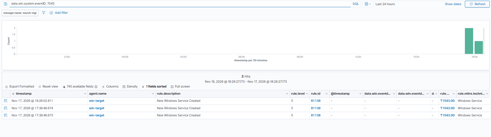
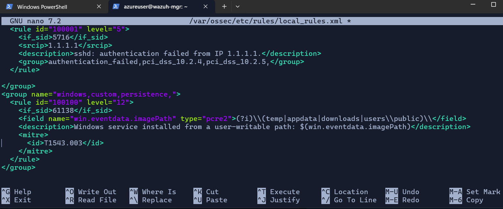
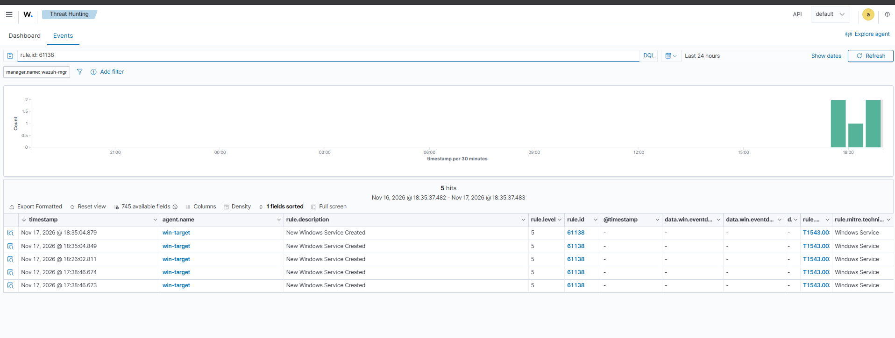
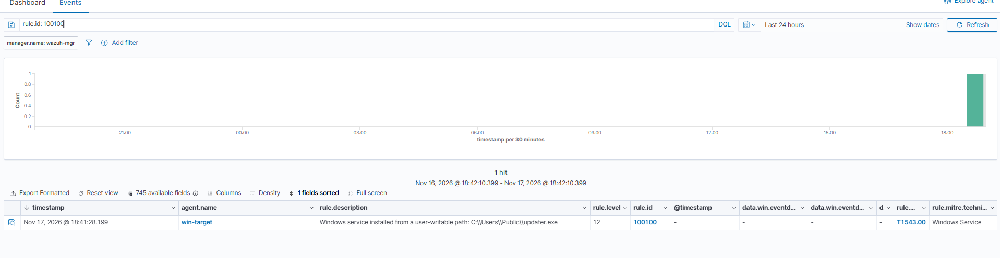
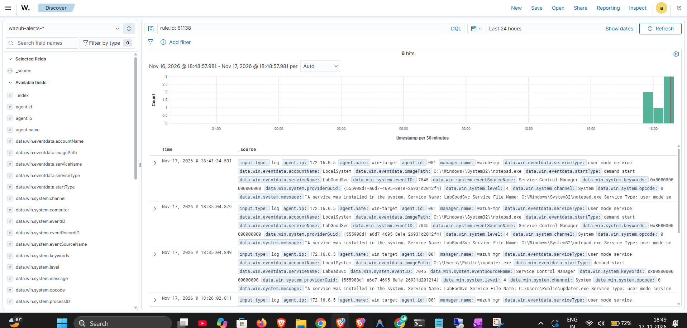

# Scenario 6: Service Installed From a User-Writable Path (custom rule)

## 1. Scenario Overview

A Windows service was created whose binary lives in a folder any user can write to. Wazuh's stock rule alerts on every new service at level 5, which is noisy. I wrote a child rule (ID 100100) that raises the level to 12 only when the service binary sits in a user-writable location, then tested it with a malicious-path service and a legitimate-path control.

---

## 2. Objective

- Create a persistence-style service and see how stock rules treat it
- Write a custom rule that separates suspicious from routine
- Test it properly: true positive, negative control, and root-cause any failure

---

## 3. Lab Environment

| Component | Detail |
|---|---|
| Target | `win-target`, Windows Server 2022 |
| Manager | `wazuh-mgr`, rules in `/var/ossec/etc/rules/local_rules.xml` |
| Parent rule | 61138, "New Windows Service Created" (Event 7045, level 5) |

---

## 4. Simulated Activity

```powershell
sc.exe create LabBadSvc  binPath= "C:\Users\Public\updater.exe"         start= demand
sc.exe create LabGoodSvc binPath= "C:\Windows\System32\notepad.exe"     start= demand
```
The services were never started. Creating the service entry is what generates Event 7045. Clean-up:
```powershell
sc.exe delete LabBadSvc
sc.exe delete LabGoodSvc
```

---

## 5. Logs Generated

| Source | Event | Key field |
|---|---|---|
| System | 7045, a service was installed | `data.win.eventdata.imagePath` |

---

## 6. Detection Logic

**Custom rule 100100** (full file: [`../detection-rules/local_rules_100100.xml`](../detection-rules/local_rules_100100.xml)):
```xml
<rule id="100100" level="12">
  <if_sid>61138</if_sid>
  <field name="win.eventdata.imagePath" type="pcre2">(?i)\\{1,2}(temp|appdata|downloads|users\\{1,2}public)\\{1,2}</field>
  <description>Windows service installed from a user-writable path: $(win.eventdata.imagePath)</description>
  <mitre><id>T1543.003</id></mitre>
</rule>
```

**Test results, in order:**

| Time (IST) | Service | Result |
|---|---|---|
| 18:26:02 | "Lab Update Helper" (`sc.exe create LabSvcUpdater ... start= auto`, running Notepad) | Only 61138 (level 5). The service name in the event is the display name. This was the baseline before I wrote the rule. |
| 18:35:04 | LabBadSvc | Only 61138 (level 5). The first version of the rule did **not** fire. |
| 18:35:04 | LabGoodSvc | Only 61138, as expected |
| 18:41:28 | LabBadSvc (after fix) | **100100 fired**, level 12 |
| 18:41:34 | LabGoodSvc (after fix) | Only 61138, so no false positive |

**Root cause of the first failure:** in this event type, Wazuh holds `imagePath` with doubled backslashes (`C:\\Users\\Public\\updater.exe`), while the human-readable message holds single ones. My first pattern matched a single backslash, so it never matched. The fix, `\\{1,2}`, accepts either form. Details in [`../investigation-notes/detection-engineering-writeup.md`](../investigation-notes/detection-engineering-writeup.md).

---

## 7. Investigation Steps

1. Confirmed the parent rule 61138 fired for both services.
2. Opened the full alert JSON and compared the stored `imagePath` with my pattern.
3. Corrected the pattern, ran `wazuh-analysisd -t` and restarted the manager.
4. Recreated the bad service and created the control, then checked `rule.id: 100100`.

---

## 8. Evidence / Screenshots

**Baseline (before the custom rule):**

| File | Description |
|---|---|
| `06-malicious-service-baseline/01-powershell-sc-create-labsvcupdater-and-query.png` | `sc.exe create` and `sc.exe qc` for "Lab Update Helper" |
| `06-malicious-service-baseline/02-wazuh-7045-events-rule-61138-3-hits.png` | Search `eventID: 7045`: three 61138 alerts (two are Sysmon's own install) |
| `06-malicious-service-baseline/03-wazuh-7045-event-details-lab-update-helper.png` | Event fields: service name, `imagePath`, start type |
| `06-malicious-service-baseline/04-wazuh-7045-event-details-rule-61138-level-5.png` | Rule fields: 61138, level 5, T1543.003 |



**Custom rule 100100: build and test:**

| File | Description |
|---|---|
| `07-custom-rule-100100/01-nano-local-rules-100100-v1-single-backslash-pattern.png` | First version of the rule in `local_rules.xml` (single-backslash pattern) |
| `07-custom-rule-100100/02-ssh-grep-7045-parent-rule-lookup.png` | Finding the parent rule that handles Event 7045 |
| `07-custom-rule-100100/03-powershell-sc-create-labbadsvc-labgoodsvc.png` | Creating the malicious-path service and the legitimate-path control |
| `07-custom-rule-100100/04-wazuh-61138-before-fix-no-100100.png` | Before the fix: only the base rule 61138 fired for both services |
| `07-custom-rule-100100/05-powershell-sc-create-retest-after-fix.png` | Re-test after fixing the pattern |
| `07-custom-rule-100100/06-wazuh-100100-fired-1-hit-level-12.png` | After the fix: rule 100100 fired once, level 12 |
| `07-custom-rule-100100/07-wazuh-100100-event-details-labbadsvc-imagepath.png` | Event fields: `imagePath` with doubled backslashes |
| `07-custom-rule-100100/08-wazuh-discover-100100-labbadsvc.png` | Discover view of the 100100 alert for LabBadSvc |
| `07-custom-rule-100100/09-wazuh-discover-61138-labgoodsvc-control.png` | Control: LabGoodSvc only under base rule 61138, no 100100 |






When 100100 fires, the parent rule 61138 is not logged separately for that event (Wazuh records the most specific matching rule), so the 61138 count only rose by one, for the control service.

Raw alert export: [`../sample-logs/100100-service-user-writable-path-alert.json`](../sample-logs/100100-service-user-writable-path-alert.json)

---

## 9. MITRE ATT&CK Mapping

| Field | Value |
|---|---|
| **Tactic** | Persistence, Privilege Escalation |
| **Technique** | T1543.003, Create or Modify System Process: Windows Service |
| **Reference** | https://attack.mitre.org/techniques/T1543/003/ |

---

## 10. Response / Remediation

- Check the binary's path, hash and signature, and who created the service
- Delete the service if unauthorised and look for other persistence
- Restrict write access to service binary locations; consider application allow-listing

---

## 11. Lessons Learned

- Escaped backslashes can make a rule fail silently. Always compare a rule with a real alert's stored fields.
- `wazuh-logtest` could not replay this event type: a pasted line was decoded as plain JSON and skipped the Windows rules. A live test with a control was the reliable method.
- A rule is not credible until it is shown **not** to fire on the benign case.
- Limitation: an attacker can use a path outside the listed folders, so this rule is one layer, not the whole defence.

---

## 12. Status

✅ Complete: 17 November 2026
