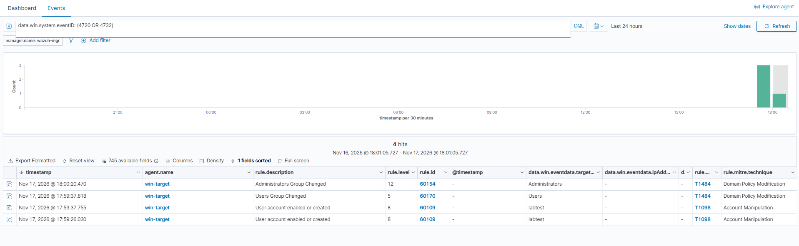
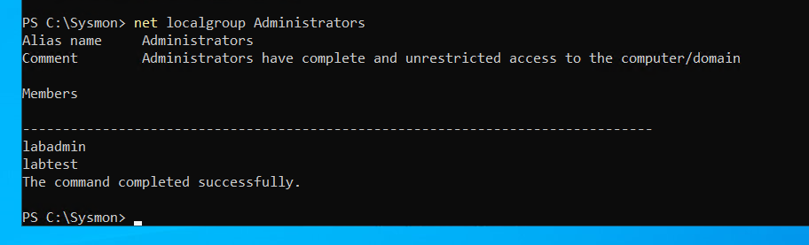

# Scenario 2: New Local Admin Account Created

## 1. Scenario Overview

A new local user, `labtest`, was created on the Windows target and then added to the local Administrators group. Wazuh raised alerts for the account creation and for the group change, and rated the privilege change at level 12.

---

## 2. Objective

- Create a user account and elevate it to administrator
- Confirm Events 4720 and 4732 are collected and alerted on
- Understand how Wazuh rates and tags each step
- Clean up the account afterwards

---

## 3. Lab Environment

| Component | Detail |
|---|---|
| Target | `win-target`, Windows Server 2022 |
| Acting account | `labadmin` |
| New account | `labtest` (temporary) |
| Detection platform | Wazuh 4.14 |

---

## 4. Simulated Activity

In an elevated PowerShell on the VM:
```powershell
net user labtest "<password>" /add
net localgroup Administrators labtest /add
net localgroup Administrators          # verify
```
Windows Server's password-complexity policy rejected a weak password on the first attempt (error 2245), so a compliant one was used. The final membership check listed `labadmin` and `labtest`.

Clean-up after the screenshots:
```powershell
net user labtest /delete
```

---

## 5. Logs Generated

| Event | Meaning |
|---|---|
| Security 4720 | A user account was created |
| Security 4732 | A member was added to a security-enabled local group |
| Security 4726 | A user account was deleted (clean-up) |

Search used:
```
data.win.system.eventID: (4720 OR 4732)
```
This returned 4 alerts.

---

## 6. Detection Logic

| Time (IST) | Rule | Level | Description | Tag shown by Wazuh |
|---|---|---|---|---|
| 17:59:26 | 60109 | 8 | User account enabled or created | T1098 |
| 17:59:37 | 60109 | 8 | User account enabled or created (account enabled) | T1098 |
| 17:59:37 | 60170 | 5 | Users Group Changed (Windows adds new users to Users automatically) | T1484 |
| 18:00:20 | 60154 | 12 | Administrators Group Changed | T1484 |

The Administrators change is the high-value event. Creating an account is routine, but a new account gaining admin rights within a minute is the pattern worth escalating.

---

## 7. Investigation Steps

1. Searched for 4720 and 4732 and read the four alerts in time order.
2. Opened the 60154 alert JSON and recorded:
   - `subjectUserName` = `labadmin` (who made the change), logon ID `0x19fa2e`
   - `targetUserName` = `Administrators`, domain `Builtin`, SID `S-1-5-32-544` (the group)
   - `memberSid` ending in `-1001` (the new account; the message shows the member name as `-` because only the SID is recorded)
3. Confirmed the actor was `labadmin`, an expected administrator in this lab.
4. Deleted the account (`net user labtest /delete` completed successfully). `[TODO: confirm Event 4726 appeared in Wazuh]`

---

## 8. Evidence / Screenshots

| File | Description |
|---|---|
| `02-new-admin-account/04-wazuh-4720-4732-alerts-rules-60109-60170-60154.png` | The four alerts (60109 x2, 60170, 60154) in Threat Hunting |
| `02-new-admin-account/03-powershell-administrators-group-members.png` | `net localgroup Administrators` listing `labadmin` and `labtest` |
| `02-new-admin-account/01-powershell-net-user-labtest-and-add-to-administrators.png` | Account creation and group-add commands |
| `02-new-admin-account/02-rdp-powershell-password-policy-error-then-account-created.png` | Password-policy rejection (error 2245), then success |




---

## 9. MITRE ATT&CK Mapping

| Field | Value |
|---|---|
| **Tactic** | Persistence, Privilege Escalation |
| **Technique** | T1136.001, Create Account: Local Account |
| **Related** | T1098, Account Manipulation |
| **Reference** | https://attack.mitre.org/techniques/T1136/001/ |

**Mapping note:** Wazuh tagged the group-change alerts with T1484 (Domain Policy Modification). That does not fit a local group change on a standalone server, so my reports use T1136.001 and T1098 instead.

---

## 10. Response / Remediation

- Verify the change was authorised (ticket, requester)
- Disable and delete the account if not
- Review everything the creating session did before and after
- Alert on 4732 for privileged groups and review membership regularly

---

## 11. Lessons Learned

- Built-in rules rated the privilege change at level 12 and the routine steps at level 5 to 8, which is sensible triage.
- Default MITRE tags are a starting point, not a verdict. Checking them against what actually happened caught a mismatch.
- A single account creation can raise several alerts, so grouping them into one timeline matters.

---

## 12. Status

✅ Complete: 17 November 2026
