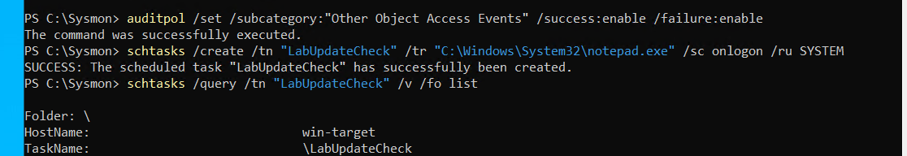
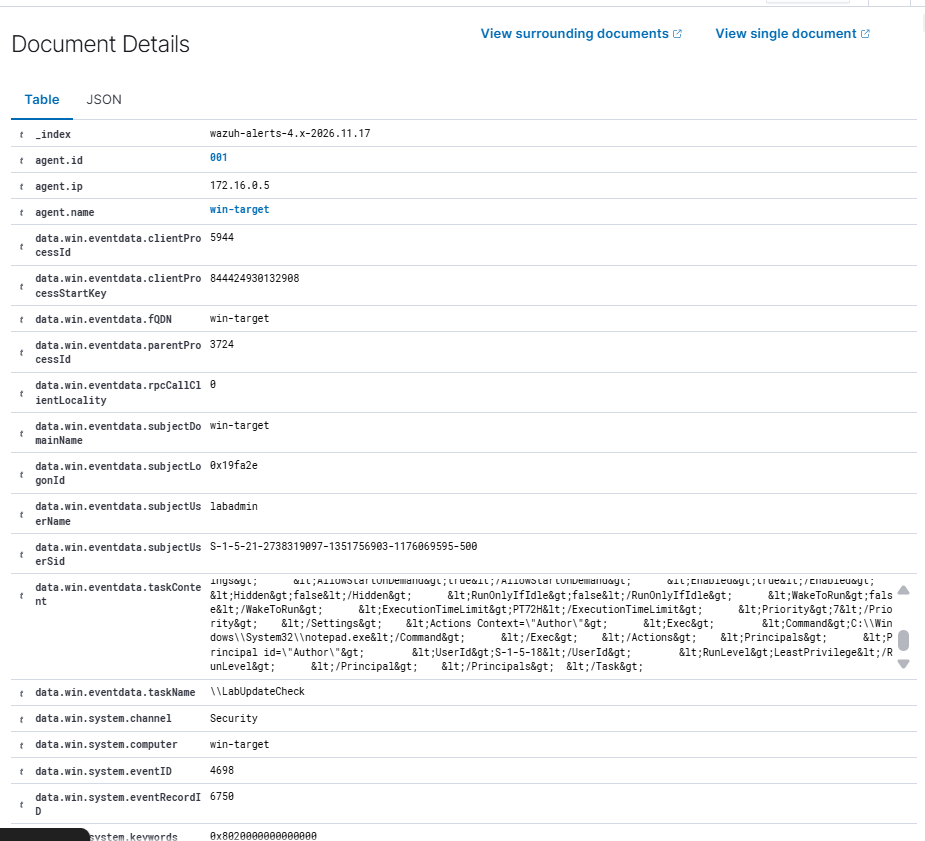
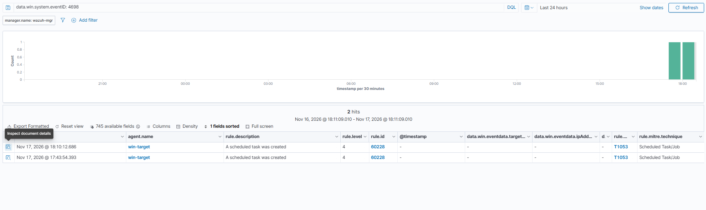
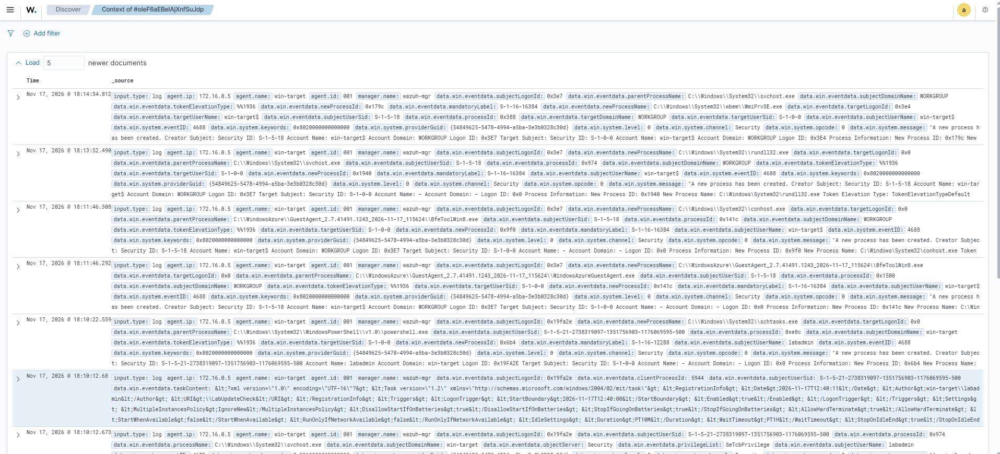

# Scenario 3: Scheduled Task Persistence

## 1. Scenario Overview

A scheduled task named `LabUpdateCheck` was created to run Notepad as SYSTEM at logon. The name imitates a routine update task, which is a common persistence trick. The activity was observed through the Windows Security log and Sysmon.

---

## 2. Objective

- Create a persistence mechanism with `schtasks`
- Make sure task creation is actually logged
- Correlate the Security event (what was created) with the Sysmon event (how it was run)

---

## 3. Lab Environment

| Component | Detail |
|---|---|
| Target | `win-target`, Windows Server 2022 |
| Acting account | `labadmin` |
| Telemetry | Security log, Sysmon/Operational |

---

## 4. Simulated Activity

I enabled auditing for task creation before the test (I did not record the baseline setting first):
```powershell
auditpol /set /subcategory:"Other Object Access Events" /success:enable /failure:enable
```
Then the task was created:
```powershell
schtasks /create /tn "LabUpdateCheck" /tr "C:\Windows\System32\notepad.exe" /sc onlogon /ru SYSTEM
schtasks /query /tn "LabUpdateCheck" /v /fo list
```
Clean-up:
```powershell
schtasks /delete /tn "LabUpdateCheck" /f
```

---

## 5. Logs Generated

| Source | Event | What it shows |
|---|---|---|
| Security | 4698, scheduled task created | Task name and the task XML (including the command) |
| Security | 4688, process creation | `schtasks.exe` started by `powershell.exe` as `labadmin` (seen in the surrounding events) |

Searches:
```
data.win.system.eventID: 4698
data.win.eventdata.newProcessName: *schtasks.exe*
```

---

## 6. Detection Logic

Event 4698 is only recorded when the "Other Object Access Events" audit subcategory is on, so detection depends on that setting. I turned it on before the test but did not check the baseline, and the 4698 search returned an earlier alert at 17:43:54 IST (before I ran `auditpol`), so this image may already have had it enabled. The dependency is the lesson either way: verify the audit policy before relying on the rule.

**Rule observed:** 60228, "A scheduled task was created", level 4 (tactics Execution, Persistence, Privilege Escalation; tagged T1053), raised at 18:10:12 IST from Event 4698. The task XML in `data.win.eventdata.taskContent` showed the `LogonTrigger`, the principal `S-1-5-18` (SYSTEM) and the command `C:\Windows\System32\notepad.exe`. The stock level is low, so a quiet persistence attempt could be overlooked.

---

## 7. Investigation Steps

1. Found the 4698 event and read the task name, creator and the command inside `taskContent`.
2. Used the creating logon ID (`0x19FA2E`) and the parent process (PID 3724, the interactive PowerShell) from the 4698 event to tie the task to the rest of the session. The surrounding events also include a Security Event 4688 (process creation) for `schtasks.exe` started by `powershell.exe` under `labadmin`, which shows where the command came from.
3. Judged the task: runs as SYSTEM, triggers at logon, generic update-style name, created by an interactive session rather than software installation.
4. Deleted the task after taking evidence.

---

## 8. Evidence / Screenshots

| File | Description |
|---|---|
| `03-scheduled-task/01-powershell-auditpol-enable-and-schtasks-create.png` | Audit policy enabled, then the task created |
| `03-scheduled-task/02-powershell-schtasks-query-labupdatecheck.png` | `schtasks /query`: runs as SYSTEM, at logon, command Notepad, last result 267011 (never run) |
| `03-scheduled-task/03-wazuh-4698-event-details-taskname-taskcontent.png` | Event 4698 fields: task name, task content, subject, logon ID, parent process |
| `03-scheduled-task/04-wazuh-4698-events-rule-60228-2-hits.png` | Search `data.win.system.eventID: 4698`: rule 60228, two hits |
| `03-scheduled-task/05-wazuh-4698-event-details-rule-60228-level-4.png` | Rule fields: 60228, level 4, tagged T1053 |
| `03-scheduled-task/06-wazuh-surrounding-documents-schtasks-process-creation-4688.png` | Surrounding events: Security 4688 for `schtasks.exe` started by `powershell.exe` |






---

## 9. MITRE ATT&CK Mapping

| Field | Value |
|---|---|
| **Tactic** | Persistence, Execution, Privilege Escalation |
| **Technique** | T1053.005, Scheduled Task/Job: Scheduled Task |
| **Reference** | https://attack.mitre.org/techniques/T1053/005/ |

---

## 10. Response / Remediation

- Review the task XML and the binary it launches (path, hash, signature)
- Delete the task if it is not authorised, and look for sibling persistence (Run keys, services)
- Keep the 4698 audit policy enabled everywhere
- Alert on tasks running as SYSTEM that launch binaries from user-writable folders

---

## 11. Lessons Learned

- A detection depends on the log existing. Checking audit policy comes before writing rules.
- Two sources together (Security for the object, Sysmon for the command line) tell a fuller story than either alone.
- Names meant to blend in (`LabUpdateCheck`) are a lead, not proof. The command and context decide.
- The 4698 search returned two hits. The earlier one, at 17:43:54 IST, predates my test and I did not investigate it. Running `auditpol /get /subcategory:"Other Object Access Events"` before changing the setting would have shown the baseline.

---

## 12. Status

✅ Complete: 17 November 2026
