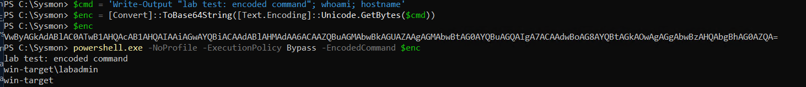
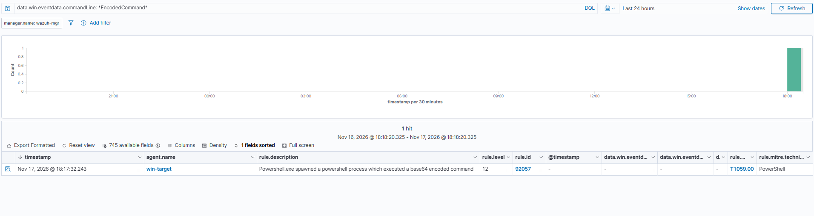
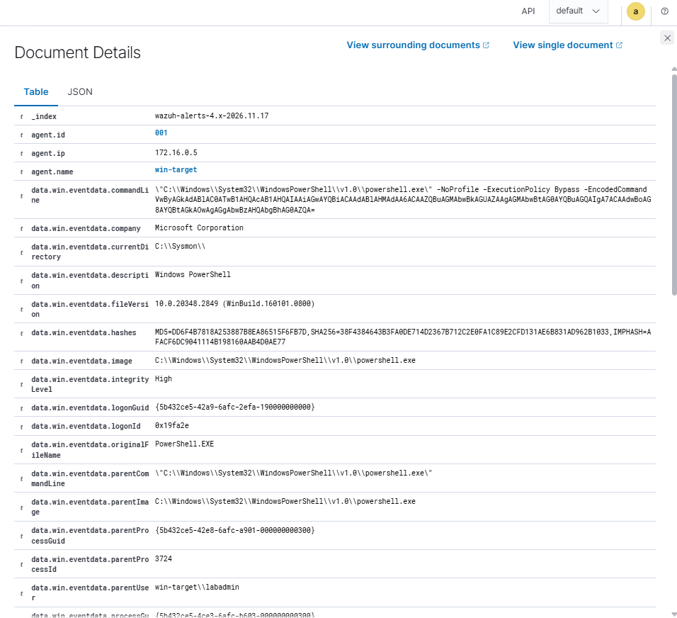
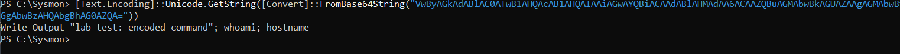

# Scenario 4: Encoded PowerShell Command

## 1. Scenario Overview

A harmless command (printing a test line, `whoami` and the host name) was Base64-encoded and run with `-EncodedCommand`, `-NoProfile` and `-ExecutionPolicy Bypass`. This combination is a common way to hide a command from casual inspection, so it is a classic hunting target.

---

## 2. Objective

- Reproduce the command-line pattern attackers use to obfuscate PowerShell
- Find it in Sysmon process-creation data in Wazuh
- Decode the payload as an analyst would

---

## 3. Lab Environment

| Component | Detail |
|---|---|
| Target | `win-target`, Windows Server 2022 |
| Telemetry | Sysmon Event 1 forwarded to Wazuh |

---

## 4. Simulated Activity

```powershell
$cmd = 'Write-Output "lab test: encoded command"; whoami; hostname'
$enc = [Convert]::ToBase64String([Text.Encoding]::Unicode.GetBytes($cmd))
powershell.exe -NoProfile -ExecutionPolicy Bypass -EncodedCommand $enc
```

Decoding as an analyst would:
```powershell
[Text.Encoding]::Unicode.GetString([Convert]::FromBase64String("<encoded string>"))
```

---

## 5. Logs Generated

| Source | Event | Key fields |
|---|---|---|
| Sysmon | Event 1, process creation | `commandLine`, `parentImage`, `user`, `image` |

Search used:
```
data.win.eventdata.commandLine: *EncodedCommand*
```

---

## 6. Detection Logic

The signal is the command line: `-EncodedCommand` together with `-ExecutionPolicy Bypass` and `-NoProfile`. Legitimate administration rarely needs all three at once.

**Rule observed:** stock rule **92057**, level **12**, "Powershell.exe spawned a powershell process which executed a base64 encoded command" (groups `sysmon`, `sysmon_eid1_detections`, `windows`), tagged T1059.001, raised at 18:17:32 IST. No custom rule was needed.

Event details: parent `powershell.exe` (PID 3724, an interactive shell), child PID 1048, user `win-target\labadmin`, integrity level High, current directory `C:\Sysmon\`, and the file hashes were included in the event.

The rule's description names a PowerShell parent. I tested only that case, so a variation (for example launching from `cmd.exe`) is untested, and a broader rule on `commandLine` is a possible improvement. A draft is in [`../draft-rules/sigma-rules.md`](../draft-rules/sigma-rules.md).

---

## 7. Investigation Steps

1. Searched for `*EncodedCommand*` and opened the Sysmon Event 1.
2. Recorded `commandLine`, `parentImage` and `user`.
3. Decoded the Base64 string to read the real command.
4. Checked the parent process, since a parent such as a document or browser would be far more suspicious than an interactive shell.

---

## 8. Evidence / Screenshots

| File | Description |
|---|---|
| `04-encoded-powershell/01-powershell-encode-and-run-encodedcommand.png` | Encoding the command and running it with `-EncodedCommand` |
| `04-encoded-powershell/03-wazuh-encodedcommand-search-rule-92057-level-12.png` | Search `*EncodedCommand*`: one hit, rule 92057, level 12 |
| `04-encoded-powershell/04-wazuh-92057-event-details-commandline-hashes-parent.png` | Event fields: command line, hashes, integrity level, parent process |
| `04-encoded-powershell/05-wazuh-92057-event-details-sysmon-channel-rule.png` | Event fields: Sysmon channel, user, UTC time, rule description |
| `04-encoded-powershell/06-powershell-decode-base64-payload.png` | Decoding the Base64 string back to the original command |






---

## 9. MITRE ATT&CK Mapping

| Field | Value |
|---|---|
| **Tactic** | Execution, Defense Evasion |
| **Technique** | T1059.001, Command and Scripting Interpreter: PowerShell |
| **Related** | T1027, Obfuscated Files or Information |
| **Reference** | https://attack.mitre.org/techniques/T1059/001/ |

---

## 10. Response / Remediation

- Decode the payload and identify what it did
- Find the parent process and the user session that started it
- Check network connections and file writes around the same time
- Isolate the host if the payload is malicious
- Enable PowerShell Script Block Logging (Event 4104) and Constrained Language Mode where possible

---

## 11. Lessons Learned

- Process-creation telemetry with full command lines is the single most useful data source for this kind of hunt.
- Encoding hides the content from a glance, but not from the logs. The encoded blob is itself the indicator.
- Script Block Logging would add the decoded content automatically. It was not enabled here, so that is a next step.

---

## 12. Status

✅ Complete: 17 November 2026
