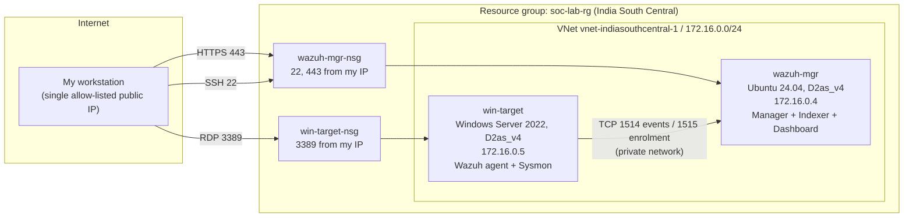

# Azure Architecture

## Notes

- Everything lives in one resource group, so one deletion removes the whole lab.
- The agent connects to the manager's **private** address, so no Wazuh ports are exposed to the internet.
- Public IP addresses exist only for administration and are not recorded in this repository.
