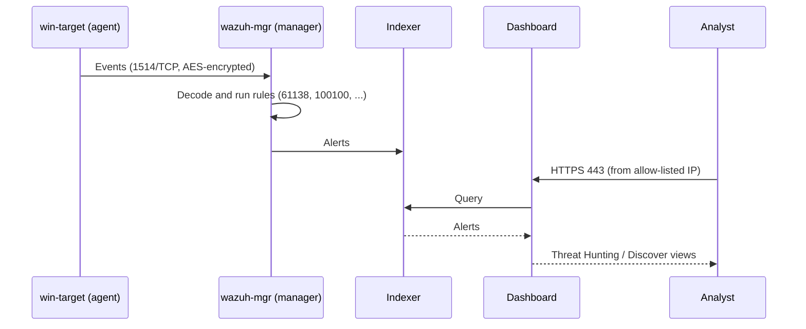

# Network Topology

```
Azure VNet 172.16.0.0/24 (subnet snet-indiasouthcentral-1)

   172.16.0.4   wazuh-mgr    Ubuntu 24.04         SIEM (manager, indexer, dashboard)
   172.16.0.5   win-target   Windows Server 2022  Monitored endpoint (agent, Sysmon)
```

## Inbound Rules

| NSG | Port | Source | Purpose |
|---|---|---|---|
| wazuh-mgr-nsg | 22 / TCP | my IP | SSH administration |
| wazuh-mgr-nsg | 443 / TCP | my IP | Wazuh dashboard |
| win-target-nsg | 3389 / TCP | my IP | RDP administration |
| both (default) | any | VirtualNetwork | Private traffic, including agent ports 1514 and 1515 |
| both (default) | any | any | Denied |

## Data Flow


