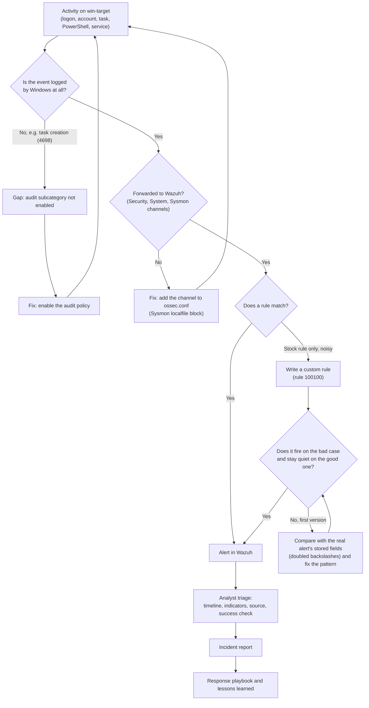

# SOC Detection Workflow

This is the workflow as it played out in this lab, including the three places where detection broke down and how each was resolved.

## The Three Breakdowns

1. **Logging dependency (scenario 3):** task creation (4698) is only recorded when the "Other Object Access Events" audit subcategory is on. I enabled it explicitly before the test. No rule can fire on a log that does not exist.
2. **Forwarding step (Sysmon):** Sysmon events only reached Wazuh after the Sysmon channel was added to the agent configuration.
3. **Rule bug (scenario 6):** the first version of rule 100100 matched single backslashes while the stored field held doubled ones, so it silently failed. It was found by comparing the rule with the real alert and verified with a negative control.

## Verification Habit

An empty result, or a rule that appears not to fire, is investigated before it is accepted: check the query, the parent rule, the stored field values and the decoder context.
