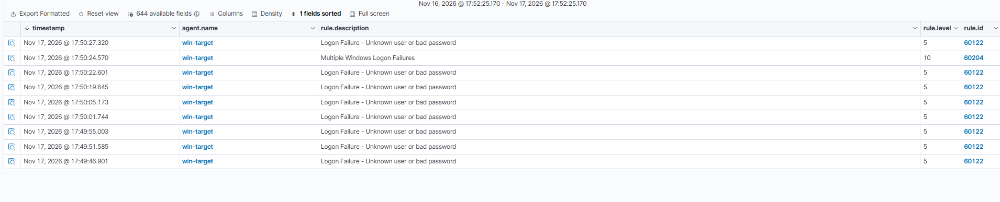
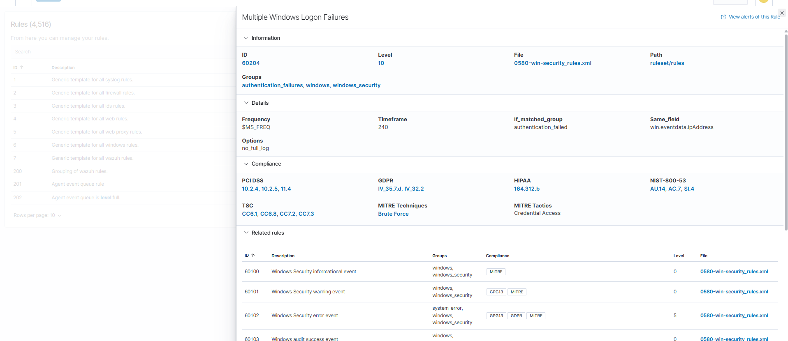

# Incident Report: Brute Force Login Attempt

**Incident ID:** IR-001-2026
**Date:** 2026-11-17
**Analyst:** Shreyas Desai
**Severity:** Medium
**Status:** Closed

---

## 1. Executive Summary

On 17 November 2026, Wazuh recorded a burst of failed Remote Desktop logons for the local administrator `labadmin` on `win-target` (172.16.0.5), over about 40 seconds. The volume tripped the level-10 rule "Multiple Windows Logon Failures". I checked for a successful logon after the failures, confirmed the source was my own workstation (the only address the NSG allows), and recorded the response a real SOC would take.

---

## 2. Incident Overview

| Field | Detail |
|---|---|
| **Incident Type** | Credential brute force against a remote service |
| **MITRE Technique** | T1110.001, Brute Force: Password Guessing |
| **Affected Host** | win-target, 172.16.0.5 |
| **Affected Account** | `labadmin` (local administrator) |
| **Detection Time** | 2026-11-17 17:50 IST |
| **Environment** | Azure VNet 172.16.0.0/24, RDP restricted to one source IP |

---

## 3. Detection Source

**Platform:** Wazuh 4.14
**Rules:** 60122 (level 5, Logon Failure) for each attempt, and 60204 (level 10, Multiple Windows Logon Failures) as the correlation alert.
**Initial indicator:** a cluster of Event 4625 entries for `labadmin` in under a minute.

---

## 4. Timeline of Events (IST)

| Time | Event | Notes |
|---|---|---|
| 17:49:46 | First failed logon (4625) | Rule 60122 |
| 17:49:46 to 17:50:27 | 8 failures recorded in total | Rule 60122 |
| 17:50:24 | Rule 60204 fires, level 10 | Correlation alert |
| 17:50:27 | Last failure in the burst | |
| about 17:51 | My own correct-password login to confirm the account was not locked out | Inferred from `labadmin` logon activity at 17:51:16 to 17:51:18, including rule 67028 (special privileges assigned) at 17:51:17 |

---

## 5. Indicators Observed

| Indicator | Value | Notes |
|---|---|---|
| Target account | `labadmin` | Local administrator |
| Source IP | My workstation's public address (redacted) | `ipAddress` field; equals the only address the NSG allows |
| Logon type | 3 (network), NTLM | RDP with Network Level Authentication authenticates before a session exists, so it logs as type 3, not 10 |
| Failure codes | Status `0xC000006D`, sub-status `0xC000006A` | Wrong password for a valid account |
| Rule 60204 | `frequency: 8` | Fired on the eighth failure in its window |
| Event IDs | 4625 (x8) | |
| Wazuh rules | 60122, 60204 | |

---

## 6. Investigation Notes

1. Searched `data.win.system.eventID: 4625` and saw 9 hits (8 attempts plus the correlation alert).
2. Opened the events and read `targetUserName`, `ipAddress` and `logonType`.
3. Looked for a 4624 from the same source after the burst. The only successful logon was my own deliberate login.
4. Conclusion: true positive for the activity pattern, no compromise, benign source (me).

In production, the source address would decide the next step. An unknown external address would be blocked immediately and the account's other logons reviewed.

---

## 7. Containment Actions

- None needed beyond verification, since the source was authorised
- In a real incident: block the source at the NSG, disable the account if a 4624 followed

---

## 8. Remediation Recommendations

- Account lockout threshold (for example 5 attempts, 30 minutes)
- Do not expose RDP to the internet; use a VPN or Azure Bastion, with MFA
- Alert on 60204 and page on a 4624 that follows within minutes

---

## 9. Lessons Learned

- Built-in rules produced a sensible two-tier alert with no custom work.
- The decisive step is looking for a success after the failures.
- Restricting the NSG to one IP is what kept the real internet's noise out of this data.

---

## 10. Evidence

| File | Description |
|---|---|
| `01-failed-login-bruteforce/02-wazuh-4625-events-table-rules-60122-60204.png` | Threat Hunting, 9 hits (8 x 60122, 1 x 60204) |
| `01-failed-login-bruteforce/04-wazuh-rule-60204-details-level-10-timeframe-240.png` | Rule 60204 definition |
| `01-failed-login-bruteforce/06-wazuh-4625-event-document-details-logon-type-3.png` | One 4625 event in detail |

Sanitised alert export: [`../sample-logs/60204-bruteforce-alert.json`](../sample-logs/60204-bruteforce-alert.json)

---

*MITRE ATT&CK: https://attack.mitre.org/techniques/T1110/001/*
*Report prepared as part of the Azure Wazuh SOC Detection Lab. All activity was performed on my own Azure resources.*
