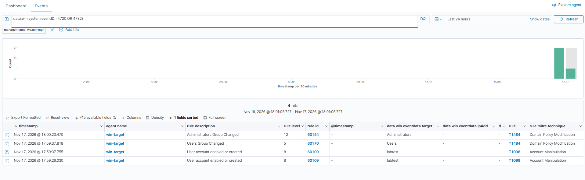
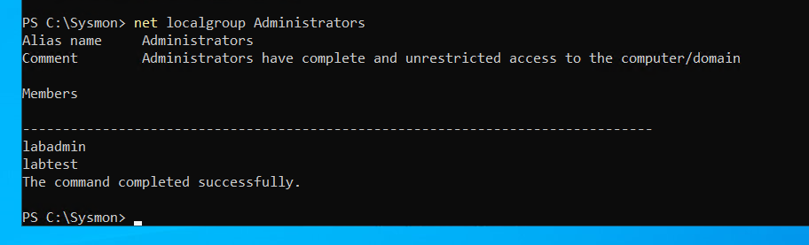

# Incident Report: New Local Administrator Account

**Incident ID:** IR-002-2026
**Date:** 2026-11-17
**Analyst:** Shreyas Desai
**Severity:** High
**Status:** Closed

---

## 1. Executive Summary

At 17:59 IST on 17 November 2026, a new local account `labtest` was created on `win-target` and, 54 seconds later, added to the local Administrators group. Wazuh alerted on both steps and rated the privilege change at level 12. The activity was my own test, but the pattern (new account, immediate admin rights) is what an attacker establishing persistence looks like, so I handled it as an incident and deleted the account afterwards.

---

## 2. Incident Overview

| Field | Detail |
|---|---|
| **Incident Type** | Unauthorised account creation and privilege escalation |
| **MITRE Technique** | T1136.001 Create Account: Local Account; T1098 Account Manipulation |
| **Affected Host** | win-target, 172.16.0.5 |
| **New Account** | `labtest` |
| **Acting Account** | `labadmin` (`subjectUserName` in the 4732 event), logon ID `0x19FA2E` |
| **Environment** | Azure lab, Windows Server 2022 |

---

## 3. Detection Source

**Platform:** Wazuh 4.14, stock rules 60109, 60170 and 60154.
**Initial indicator:** a level-12 "Administrators Group Changed" alert.

---

## 4. Timeline of Events (IST)

| Time | Event | Rule | Level |
|---|---|---|---|
| 17:59:26 | Account `labtest` created (4720) | 60109 | 8 |
| 17:59:37 | Account enabled | 60109 | 8 |
| 17:59:37 | Added to Users (automatic) | 60170 | 5 |
| 18:00:20 | Added to Administrators (4732) | 60154 | 12 |
| later | Account deleted (4726) `[TODO: time]` | n/a | n/a |

---

## 5. Indicators Observed

| Indicator | Value |
|---|---|
| New account | `labtest` |
| Group changed | Administrators |
| Actor | `labadmin`, logon ID `0x19FA2E` |
| Group | `Builtin\Administrators` (SID `S-1-5-32-544`) |
| Event IDs | 4720, 4732, 4726 |

---

## 6. Investigation Notes

1. Read the four alerts in time order and grouped them into one sequence.
2. Opened the 60154 alert and identified who made the change and which account was added.
3. Confirmed the actor was an expected administrator, and that the change matched my planned test.
4. Noted that Wazuh tagged the group changes as T1484 (Domain Policy Modification), which does not fit a local group on a standalone server. I used T1136.001 and T1098.

**Conclusion:** true positive for the technique, authorised in this case.

---

## 7. Containment Actions

- Deleted the account with `net user labtest /delete`
- Verified the Administrators group no longer listed it

---

## 8. Remediation Recommendations

- Alert on any 4732 for privileged groups and require a ticket
- Review local administrator membership on a schedule
- Correlate 4720 and 4732 for the same account inside a short window

---

## 9. Lessons Learned

- The level ratings (5 for routine, 12 for privilege change) are a good guide to what to look at first.
- Default ATT&CK tags can be wrong. Check them against the facts.
- Several alerts belong to one story, so build the timeline before judging severity.

---

## 10. Evidence

| File | Description |
|---|---|
| `02-new-admin-account/04-wazuh-4720-4732-alerts-rules-60109-60170-60154.png` | The four alerts |
| `02-new-admin-account/03-powershell-administrators-group-members.png` | `net localgroup Administrators` listing `labtest` |

Sanitised alert export: [`../sample-logs/60154-admin-group-changed-alert.json`](../sample-logs/60154-admin-group-changed-alert.json)

---

*MITRE ATT&CK: https://attack.mitre.org/techniques/T1136/001/*
*Report prepared as part of the Azure Wazuh SOC Detection Lab.*
