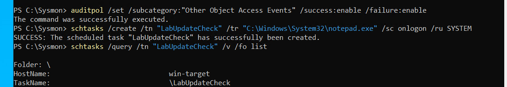
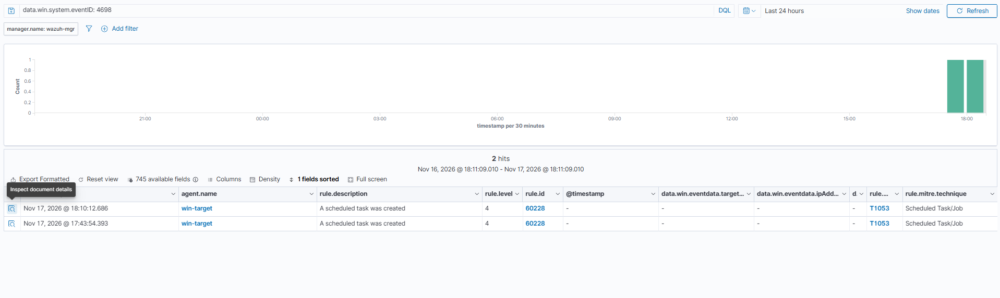
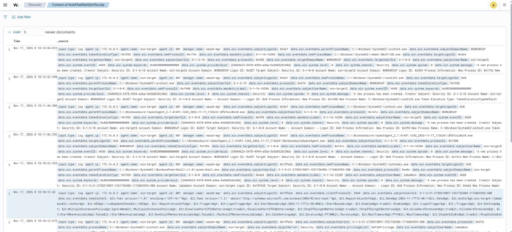

# Incident Report: Scheduled Task Persistence

**Incident ID:** IR-003-2026
**Date:** 2026-11-17
**Analyst:** Shreyas Desai
**Severity:** Medium
**Status:** Closed

---

## 1. Executive Summary

At 18:10 IST on 17 November 2026, a scheduled task named `LabUpdateCheck` was created on `win-target` by the local administrator `labadmin`. It was set to run a program as SYSTEM at every logon, and its name imitates a routine update job. Wazuh alerted on the task creation (rule 60228) and the full task definition was captured in the event. The program was Notepad, a harmless stand-in, and the task was deleted afterwards. Task creation is only recorded when the "Other Object Access Events" audit subcategory is enabled, so I switched it on first.

---

## 2. Incident Overview

| Field | Detail |
|---|---|
| **Incident Type** | Persistence via scheduled task |
| **MITRE Technique** | T1053.005 Scheduled Task/Job: Scheduled Task (Wazuh tags it T1053) |
| **Affected Host** | win-target, 172.16.0.5 |
| **Task** | `\LabUpdateCheck`, trigger: at logon, runs as SYSTEM (`S-1-5-18`) |
| **Command** | `C:\Windows\System32\notepad.exe` |
| **Creator** | `labadmin`, logon session `0x19FA2E` |

---

## 3. Detection Source

**Platform:** Wazuh 4.14
**Rule:** 60228 "A scheduled task was created", level 4, tactics Execution / Persistence / Privilege Escalation
**Underlying event:** Security Event 4698, which depends on the "Other Object Access Events" audit subcategory (I enabled it before the test).

---

## 4. Timeline of Events (IST)

| Time | Event |
|---|---|
| before 18:10 | `auditpol /set /subcategory:"Other Object Access Events" ...` run successfully |
| 18:10:11 | Event 4698 written on the VM (12:40:11 UTC) |
| 18:10:12 | Wazuh alert, rule 60228 |
| shortly after | `schtasks /query` showed status Ready, run as SYSTEM, trigger "At logon time", last result 267011 (never run) |
| shortly after | Task deleted with `schtasks /delete` |

---

## 5. Indicators Observed

| Indicator | Value |
|---|---|
| Task name | `\LabUpdateCheck` |
| Author | `win-target\labadmin` |
| Trigger | LogonTrigger |
| Run as | SYSTEM (`S-1-5-18`), run level LeastPrivilege |
| Command | `C:\Windows\System32\notepad.exe` |
| Creating logon ID | `0x19FA2E` |
| Parent process of the creator | PID 3724 (the interactive PowerShell session) |
| Event IDs | 4698 |
| Wazuh rule | 60228 (level 4) |

---

## 6. Investigation Notes

1. Opened the 60228 alert and read `data.win.eventdata.taskName`, `subjectUserName` and `taskContent`. The task XML shows the trigger, the principal and the `<Command>`.
2. Judged the task: runs as SYSTEM, triggers at logon, has a name designed to blend in, and was created from an interactive administrator session rather than by an installer.
3. Tied it to the rest of the session: the same logon ID (`0x19FA2E`) and the same parent PowerShell process (PID 3724) also appear in the encoded-PowerShell and log-clearing events (IR-004, IR-005). Together they describe one administrator session doing several suspicious things.
4. Noted the dependency: task creation is only recorded when that audit subcategory is enabled. The 4698 search also returned an earlier alert at 17:43:54 IST that predates my test, so I cannot say what this image's baseline was.
5. The surrounding events include a Security 4688 process-creation record for `schtasks.exe` started by `powershell.exe` under `labadmin`, which shows the origin of the command without Sysmon.

**Conclusion:** persistence technique reproduced and detected. Severity is Medium because the stock rule's level is only 4 and the payload was harmless. A real task running an unknown binary as SYSTEM would warrant High.

---

## 7. Containment Actions

- Deleted the task: `schtasks /delete /tn "LabUpdateCheck" /f` (confirmed successful)
- Real case: inspect and hash the binary, then look for related persistence (Run keys, services, other tasks)

---

## 8. Remediation Recommendations

- Enable "Other Object Access Events" auditing on every Windows host
- Alert on tasks running as SYSTEM whose command sits in a user-writable folder
- Raise the level of rule 60228 for tasks created outside of installer activity (stock level is 4)
- Add Sysmon process-creation coverage for `schtasks.exe` to see the exact command line

---

## 9. Lessons Learned

- A detection needs a log. Checking audit policy comes before writing rules.
- The task XML inside the alert shows exactly what would run, so no extra tool was needed.
- Several events from one logon ID and one parent process turn separate alerts into a single story.
- The stock rule is low priority (level 4), so a quiet persistence attempt could be missed in a busy SOC.

---

## 10. Evidence

| File | Description |
|---|---|
| `03-scheduled-task/01-powershell-auditpol-enable-and-schtasks-create.png` | Audit policy enabled and task created |
| `03-scheduled-task/03-wazuh-4698-event-details-taskname-taskcontent.png` | Event 4698 details |
| `03-scheduled-task/04-wazuh-4698-events-rule-60228-2-hits.png` | Rule 60228 alerts |
| `03-scheduled-task/06-wazuh-surrounding-documents-schtasks-process-creation-4688.png` | Surrounding events: 4688 for `schtasks.exe` |

Sanitised alert export: [`../sample-logs/60228-scheduled-task-created-alert.json`](../sample-logs/60228-scheduled-task-created-alert.json)

---

*MITRE ATT&CK: https://attack.mitre.org/techniques/T1053/005/*
*Report prepared as part of the Azure Wazuh SOC Detection Lab.*
