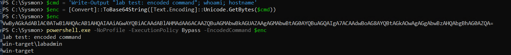
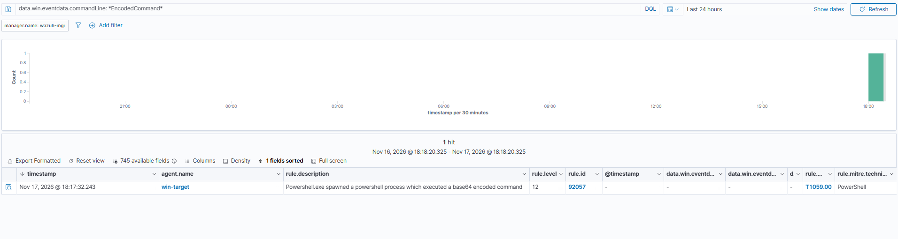
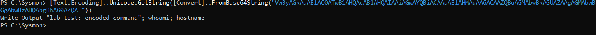

# Incident Report: Encoded PowerShell Execution

**Incident ID:** IR-004-2026
**Date:** 2026-11-17
**Analyst:** Shreyas Desai
**Severity:** High
**Status:** Closed

---

## 1. Executive Summary

At 18:17 IST on 17 November 2026, an interactive PowerShell session on `win-target` started a second PowerShell process with `-NoProfile -ExecutionPolicy Bypass -EncodedCommand` followed by a Base64 string. Wazuh raised stock rule 92057 at level 12 within about a second. I decoded the payload, which was a harmless test (it printed a line, the user name and the host name), and confirmed the event carried everything needed to investigate: the full command line, the parent process, the user, the integrity level and the file hashes.

---

## 2. Incident Overview

| Field | Detail |
|---|---|
| **Incident Type** | Obfuscated script execution |
| **MITRE Technique** | T1059.001 PowerShell (tagged by Wazuh); related T1027 Obfuscated Files or Information |
| **Affected Host** | win-target, 172.16.0.5 |
| **User** | `win-target\labadmin`, integrity level High |
| **Detection Time** | 2026-11-17 18:17:32 IST |

---

## 3. Detection Source

**Platform:** Wazuh 4.14 with Sysmon Event 1 forwarded from the agent
**Rule:** 92057, level 12, "Powershell.exe spawned a powershell process which executed a base64 encoded command" (groups: `sysmon`, `sysmon_eid1_detections`, `windows`), tactic Execution
**Search used to find it:** `data.win.eventdata.commandLine: *EncodedCommand*`

---

## 4. Timeline of Events (IST)

| Time | Event |
|---|---|
| 18:17:31 | Sysmon Event 1: `powershell.exe -NoProfile -ExecutionPolicy Bypass -EncodedCommand ...` (UTC 12:47:31) |
| 18:17:32 | Wazuh alert, rule 92057, level 12 |
| after | I decoded the Base64 string and confirmed the payload |

---

## 5. Indicators Observed

| Indicator | Value |
|---|---|
| Image | `C:\Windows\System32\WindowsPowerShell\v1.0\powershell.exe`, PID 1048 |
| Flags | `-NoProfile`, `-ExecutionPolicy Bypass`, `-EncodedCommand` |
| Encoded string | `VwByAGkAdABlAC0ATwB1AHQAcAB1AHQAIAAiAGwAYQBiACAAdABlAHMAdAA6ACAAZQBuAGMAbwBkAGUAZAAgAGMAbwBtAG0AYQBuAGQAIgA7ACAAdwBoAG8AYQBtAGkAOwAgAGgAbwBzAHQAbgBhAG0AZQA=` |
| Decoded content | `Write-Output "lab test: encoded command"; whoami; hostname` |
| Parent | `powershell.exe`, PID 3724, plain command line (an interactive shell) |
| User | `win-target\labadmin`, logon ID `0x19FA2E` |
| Current directory | `C:\Sysmon\` |
| SHA-256 of the image | `38F4384643B3FA0DE714D2367B712C2E0FA1C89E2CFD131AE6B831AD962B1033` |

---

## 6. Investigation Notes

1. Opened the alert and read `commandLine`, `parentImage`, `parentCommandLine`, `user` and `integrityLevel`.
2. Decoded the string with `[Text.Encoding]::Unicode.GetString([Convert]::FromBase64String(...))`, which returned the harmless test command.
3. Judged the parent: an interactive PowerShell with a plain command line. That is normal for an administrator and would be far more suspicious if the parent were an Office program or a browser.
4. Noticed that the stock rule's description names a PowerShell parent. I only tested that case, so I do not know how it behaves with other parents such as `cmd.exe`.
5. Cross-checked the session: the same logon ID (`0x19FA2E`) and parent PID (3724) appear in the scheduled-task and log-clearing events.

**Conclusion:** technique reproduced and detected at a high level with no custom work.

---

## 7. Containment Actions

- None required (harmless payload)
- Real case: kill the process tree, isolate the host, preserve memory and logs, and check network connections and child processes

---

## 8. Remediation Recommendations

- Enable PowerShell Script Block Logging (Event 4104) so the decoded script is logged without manual decoding
- Test whether the detection still fires when the encoded command is launched from other parents, and add a rule if not
- Use Constrained Language Mode or application allow-listing on servers

---

## 9. Lessons Learned

- The Sysmon event carried the full context in one place, which made the investigation quick.
- Encoding hides content from a glance but not from process telemetry. The blob itself is the indicator.
- Rule 92057 is specific about its parent, so a variation of the technique could slip past it. That is worth testing.

---

## 10. Evidence

| File | Description |
|---|---|
| `04-encoded-powershell/01-powershell-encode-and-run-encodedcommand.png` | The command and its output |
| `04-encoded-powershell/03-wazuh-encodedcommand-search-rule-92057-level-12.png` | Rule 92057 alert |
| `04-encoded-powershell/04-wazuh-92057-event-details-commandline-hashes-parent.png` | Sysmon event details |
| `04-encoded-powershell/06-powershell-decode-base64-payload.png` | Decoded payload |

Sanitised alert export: [`../sample-logs/92057-powershell-encoded-alert.json`](../sample-logs/92057-powershell-encoded-alert.json)

---

*MITRE ATT&CK: https://attack.mitre.org/techniques/T1059/001/*
*Report prepared as part of the Azure Wazuh SOC Detection Lab.*
