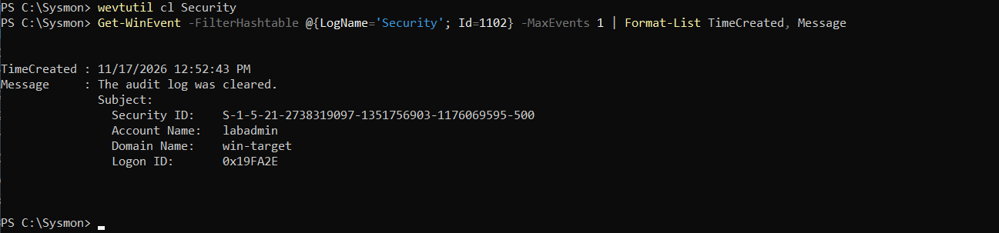
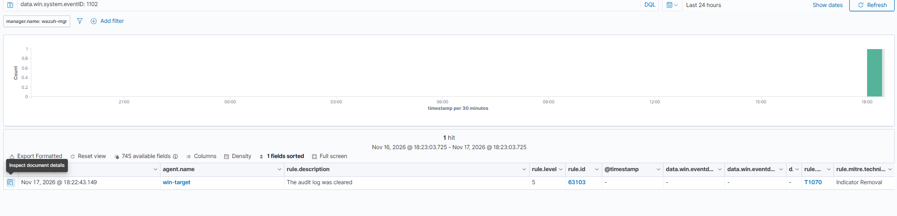
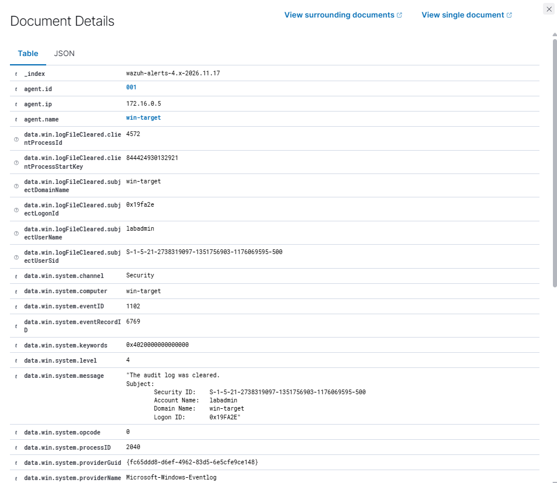

# Incident Report: Security Log Cleared

**Incident ID:** IR-005-2026
**Date:** 2026-11-17
**Analyst:** Shreyas Desai
**Severity:** High
**Status:** Closed

---

## 1. Executive Summary

At 18:22 IST on 17 November 2026, the Windows Security event log on `win-target` was cleared with `wevtutil cl Security` by `labadmin`. Windows wrote Event 1102 as the first entry of the new log and Wazuh alerted on it with stock rule 63103. The local log was emptied, but every earlier event stayed in Wazuh because the agent had already forwarded it. One point stands out: Wazuh rates this rule only **level 5**, which is low for an action attackers use to hide their tracks, so I rate the incident High and recommend raising the rule's level.

---

## 2. Incident Overview

| Field | Detail |
|---|---|
| **Incident Type** | Defense evasion: audit log clearing |
| **MITRE Technique** | T1070.001 Indicator Removal: Clear Windows Event Logs (Wazuh tags the parent, T1070) |
| **Affected Host** | win-target, 172.16.0.5 |
| **Account** | `win-target\labadmin`, logon ID `0x19FA2E` |
| **Detection Time** | 2026-11-17 18:22:43 IST |

---

## 3. Detection Source

**Platform:** Wazuh 4.14
**Rule:** 63103, level 5, "The audit log was cleared" (groups: `windows`, `windows_logs`, `log_clearing_auditlog`), tactic Defense Evasion
**Underlying event:** Security Event 1102, provider `Microsoft-Windows-Eventlog`
**Search used:** `data.win.system.eventID: 1102`

---

## 4. Timeline of Events (IST)

| Time | Event |
|---|---|
| shortly before 18:22:43 | `wevtutil cl Security` executed in the `labadmin` PowerShell session |
| 18:22:43 | Event 1102 written (UTC 12:52:43), Wazuh alert raised in the same second |
| after | `Get-WinEvent` for Id 1102 confirmed the event and named `labadmin` as the subject |

---

## 5. Indicators Observed

| Indicator | Value |
|---|---|
| Event ID | 1102 |
| Subject | `labadmin` (domain `win-target`), logon ID `0x19FA2E` |
| Client process ID | 4572 (field `logFileCleared.clientProcessId`) |
| Wazuh rule | 63103 (level 5) |
| Command | `wevtutil cl Security` |

---

## 6. Investigation Notes

1. Opened the alert and read the subject account and logon ID from `data.win.logFileCleared`.
2. Matched the logon ID `0x19FA2E` to the other events in this session (the scheduled task and the encoded PowerShell), which shows what the same session did just before clearing the log.
3. Compared the local Security log (almost empty) with Wazuh (complete history).
4. Noted the rule level: 5, with no email alert configured by default.

**Conclusion:** the clear was detected and its actor identified, and the earlier evidence survived in the SIEM.

---

## 7. Containment Actions

- Real case: treat as likely compromise, identify and end the session, preserve Wazuh data and take disk or memory images

---

## 8. Remediation Recommendations

- Raise rule 63103 to a high level (for example 12) with a custom rule, and alert on Event 104 (System log cleared) too
- Restrict who may clear logs
- Forward logs to a system the endpoint's administrators cannot alter

---

## 9. Lessons Learned

- Central collection defeated the evasion attempt. That is the practical argument for off-host logging.
- A stock rule can be correct and still badly prioritised. Default levels deserve review.
- One logon ID connects the log clear to the earlier suspicious actions in the same session.

---

## 10. Evidence

| File | Description |
|---|---|
| `05-audit-log-cleared/01-powershell-wevtutil-clear-security-and-event-1102.png` | Clearing the log and reading event 1102 |
| `05-audit-log-cleared/03-wazuh-1102-search-rule-63103-level-5.png` | Rule 63103 alert |
| `05-audit-log-cleared/04-wazuh-1102-event-details-logfilecleared-fields.png` | Who cleared the log |

Sanitised alert export: [`../sample-logs/63103-log-cleared-alert.json`](../sample-logs/63103-log-cleared-alert.json)

---

*MITRE ATT&CK: https://attack.mitre.org/techniques/T1070/001/*
*Report prepared as part of the Azure Wazuh SOC Detection Lab.*
