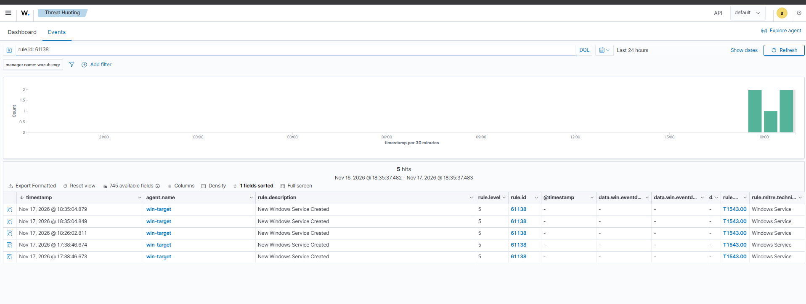
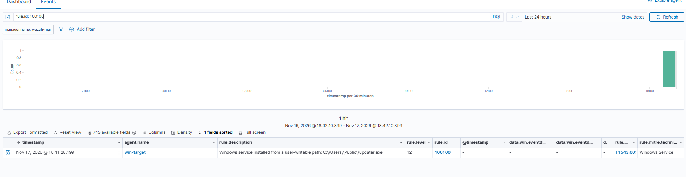
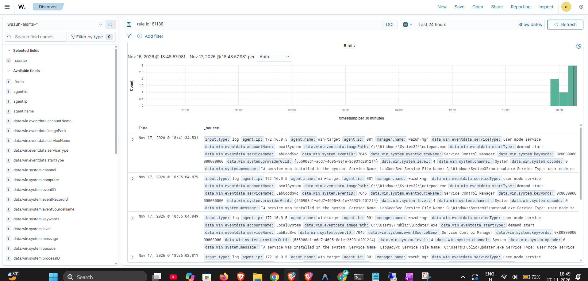

# Incident Report: Service Installed From a User-Writable Path

**Incident ID:** IR-006-2026
**Date:** 2026-11-17
**Analyst:** Shreyas Desai
**Severity:** High
**Status:** Closed

---

## 1. Executive Summary

A Windows service `LabBadSvc` was created on `win-target` with its binary in `C:\Users\Public\`, a folder any user can write to. Wazuh's stock rule alerts on every new service at level 5, so the event was easy to miss among routine service installs. I wrote custom rule 100100 to escalate such services to level 12. The first version silently failed because of how Wazuh stores backslashes in this field. After fixing the pattern, the rule fired on the malicious path and stayed quiet on a legitimate one (`LabGoodSvc` in `System32`).

---

## 2. Incident Overview

| Field | Detail |
|---|---|
| **Incident Type** | Persistence via Windows service |
| **MITRE Technique** | T1543.003 Create or Modify System Process: Windows Service |
| **Affected Host** | win-target, 172.16.0.5 |
| **Service** | `LabBadSvc`, `C:\Users\Public\updater.exe`, runs as LocalSystem |
| **Environment** | Azure lab, Wazuh 4.14 |

---

## 3. Detection Source

**Platform:** Wazuh 4.14.
**Stock rule:** 61138 "New Windows Service Created", level 5.
**Custom rule:** 100100, level 12 ([`../detection-rules/local_rules_100100.xml`](../detection-rules/local_rules_100100.xml)).

---

## 4. Timeline of Events (IST)

| Time | Event | Result |
|---|---|---|
| 18:35:04 | LabBadSvc and LabGoodSvc created | Only 61138. Custom rule v1 did not fire. |
| 18:36 to 18:40 | Diagnosed doubled backslashes in `imagePath`; pattern changed to `\\{1,2}`; manager restarted | n/a |
| 18:41:28 | LabBadSvc recreated | **100100 fired**, level 12 |
| 18:41:34 | LabGoodSvc recreated | Only 61138, no false positive |

---

## 5. Indicators Observed

| Indicator | Value |
|---|---|
| Event ID | 7045 |
| Service name | LabBadSvc |
| Image path | `C:\Users\Public\updater.exe` (stored as `C:\\Users\\Public\\updater.exe`) |
| Account | LocalSystem |
| Start type | Demand |
| Rule | 100100 (level 12) |

---

## 6. Investigation Notes

1. Both services raised the stock alert, so the parent rule was working.
2. Opened the full alert JSON and compared the stored `imagePath` with my pattern. It held two backslashes per separator, not one.
3. Corrected the pattern and re-tested with a malicious-path service and a control.
4. Saved the alert JSON ([`../sample-logs/`](../sample-logs/)).

Full engineering account: [`../investigation-notes/detection-engineering-writeup.md`](../investigation-notes/detection-engineering-writeup.md).

---

## 7. Containment Actions

- Deleted both test services: `sc.exe delete LabBadSvc`, `sc.exe delete LabGoodSvc`
- Real case: inspect and hash the binary, find who created the service, remove it and search for related persistence

---

## 8. Remediation Recommendations

- Alert on service installs from user-writable locations (done: rule 100100)
- Restrict write access to service binary folders; use application allow-listing
- Add an allow-list for legitimate per-user software, and add the creator and parent process from Sysmon

---

## 9. Lessons Learned

- Test the failing case too. A rule that was never shown to fail on the benign sample proves little.
- Compare a rule with the stored field values in a real alert, not with the readable message.
- `wazuh-logtest` could not replay this event, so live testing with a control was necessary.
- The rule is one layer. An attacker can choose another path.

---

## 10. Evidence

| File | Description |
|---|---|
| `07-custom-rule-100100/01-nano-local-rules-100100-v1-single-backslash-pattern.png` | First version of the rule |
| `07-custom-rule-100100/04-wazuh-61138-before-fix-no-100100.png` | Before the fix: base rule only |
| `07-custom-rule-100100/06-wazuh-100100-fired-1-hit-level-12.png` | After the fix: rule 100100 fired |
| `07-custom-rule-100100/09-wazuh-discover-61138-labgoodsvc-control.png` | Negative control |

Sanitised alert exports: [`100100`](../sample-logs/100100-service-user-writable-path-alert.json), [`61138 control`](../sample-logs/61138-negative-control-labgoodsvc-alert.json)

---

*MITRE ATT&CK: https://attack.mitre.org/techniques/T1543/003/*
*Report prepared as part of the Azure Wazuh SOC Detection Lab.*
